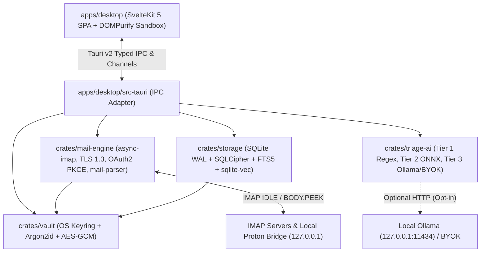

# triage-mail

**100% Local-First, Provider-Agnostic Email Aggregator and Triage Engine built with Rust, Tauri v2, SQLite (SQLCipher + FTS5 + sqlite-vec), and SvelteKit 5.**

**[English](README.md)** | **[Português (Brasil)](README.pt-br.md)**

[](https://github.com/ye-sandbox/triage-mail/actions/workflows/ci.yml)


---

## Overview

`triage-mail` is an inbound-focused email unification, hybrid search, and automated triage engine designed for users managing multiple accounts across Gmail, Outlook/Microsoft 365, Yahoo, iCloud, Proton Mail Bridge, and custom IMAP domains. Rather than acting as a bloated legacy suite, it focuses strictly on high-throughput unified reading, instant retrieval, and local-first extraction.

All credentials, message bodies, and semantic indices reside exclusively on the user's machine under encryption at rest, with zero telemetry and zero external sidecar runtimes:

- **Native Binary & Low Footprint:** Pure Rust (`tokio`) + Tauri v2 + SvelteKit 5 SPA (lean native desktop binary with zero Electron/Node/Python backend processes).
- **Sub-15ms Hybrid Search:** Combines configurable lexical exact match via SQLite `FTS5` (default `unicode61 remove_diacritics 2`, optional `trigram`) and local semantic vector KNN via embedded `sqlite-vec` (`int8` quantized with pre-filtering).
- **60fps Virtualized Unified Inbox:** Engineered to scroll through `100k+` messages smoothly with keyboard-first triage (`Command Palette`), incremental `UIDVALIDITY`/`CONDSTORE` sync, and two-way IMAP flag synchronization.
- **Transparent Multi-Mode Authentication:** Supports App Passwords, OAuth2 Public PKCE, user-supplied BYO OAuth (`client_id`/`client_secret` stored in the OS vault), standard IMAP TLS 1.3, and local Proton Mail Bridge behind an agnostic `ImapConnector`.
- **3-Tier Local-First AI Pipeline:**
  - *Tier 1 (Deterministic, Zero Cost):* Native Rust regex and heuristics for instant extraction of 2FA/OTP codes, FEBRABAN Boletos (with deterministic BRL amount and due date extraction), Pix EMV/keys, NF-e metadata, package tracking numbers, `List-Unsubscribe` + RFC 8058 One-Click Unsubscribe (`List-Unsubscribe-Post`), and automatic categorization (`Financial`, `Security`, `Newsletter`, `Personal`).
  - *Tier 2 (Local CPU Embeddings):* Background semantic indexing using quantized ONNX models (`all-MiniLM-L6-v2` / `bge-small`) via `fastembed-rs` / `ort` cached on demand in the user's data directory.
  - *Tier 3 (Optional Generative LLM):* On-demand thread summarization via local Ollama (`http://127.0.0.1:11434`) or explicit BYOK cloud providers.
- **Zero-Knowledge Security & Safe Rendering:** OS Keyring integration (`keyring` + `argon2` fallback vault), full-database SQLCipher AES-256 storage, lazy attachment fetching (`IMAP BODY.PEEK` on demand), and strict HTML sanitization (`DOMPurify` inside `<iframe sandbox="">` with normalized dark-mode CSS and remote tracking pixels blocked by default).

## Architecture

The repository is structured as a modular Cargo Workspace so the core Rust crates (`mail-engine`, `storage`, `vault`, `triage-ai`) remain completely decoupled from the GUI and can run headless in a CLI or container:



## Quickstart

### Prerequisites

- **Rust Toolchain:** `rustup` (`stable`, Rust 2021/2024 edition) + platform system libraries for Tauri v2 (`libwebkit2gtk-4.1-dev`, `libsecret-1-dev` on Linux).
- **Node.js & Package Manager:** Node.js `24.19.0` and `pnpm 11.25.0` (matching CI).

On Ubuntu 24.04, install the native build prerequisites (also used by CI):

```bash
sudo apt-get update
sudo apt-get install --no-install-recommends -y \
  build-essential pkg-config perl libssl-dev libwebkit2gtk-4.1-dev \
  libgtk-3-dev libsecret-1-dev libayatana-appindicator3-dev librsvg2-dev
```

### Setup & Verification

```bash
# 1. Copy development environment defaults
cp .env.example .env

# 2. Install frontend dependencies
pnpm install --frozen-lockfile

# 3. Verify Rust workspace compilation and unit tests
cargo test --workspace

# 4. Start the frontend; in another terminal run cargo run --package triage-mail-desktop
pnpm --filter desktop dev --port 1420
```

## Configuration

Runtime credentials and database encryption keys are stored strictly in the operating system keyring (`crates/vault`), never in plaintext configuration files. The `.env.example` file defines optional development overrides:

| Variable | Description | Default | Required |
| :--- | :--- | :--- | :--- |
| `RUST_LOG` | Tracing filter directives for Rust crates | `info,triage_mail=debug,mail_engine=info,storage=info` | No |
| `TRIAGE_DB_PATH` | Development override path for local SQLCipher database | `./.agent/scratch/dev-triage.db` | No |
| `TRIAGE_EMBEDDING_MODEL` | Local ONNX embedding model identifier for Tier 2 indexing | `all-MiniLM-L6-v2` | No |
| `OLLAMA_BASE_URL` | Local Ollama HTTP endpoint for Tier 3 on-demand summaries | `http://127.0.0.1:11434` | No |
| `OLLAMA_MODEL` | Default local Ollama model tag | `qwen2.5:3b` | No |
| `PROTON_BRIDGE_HOST` | Local loopback address for Proton Mail Bridge IMAP | `127.0.0.1` | No |
| `PROTON_BRIDGE_PORT` | Local loopback port for Proton Mail Bridge IMAP | `1143` | No |

## Usage

```bash
# Run headless core crate tests (MIME parsing, deterministic 2FA/Boleto triage, storage)
cargo test --workspace

# Build the SPA, then the native desktop binary (no installer packaging)
pnpm --filter desktop build
cargo build --release --package triage-mail-desktop
```

## Development

### Repository Structure

```text
.
├── .agent/                   # ADD governance, active contracts (NOTES.md), and task roadmap (TASK.md)
├── apps/
│   └── desktop/              # SvelteKit 5 SPA frontend + Tauri v2 (src-tauri) entrypoint
├── crates/
│   ├── mail-engine/          # Async IMAP, OAuth2 PKCE loopback, IDLE manager, RFC 5322 MIME parser
│   ├── storage/              # SQLite WAL + SQLCipher, migrations, FTS5, and sqlite-vec
│   ├── triage-ai/            # Tier 1 Regex (2FA/Boletos/Tracking), Tier 2 ONNX, Tier 3 LLM client
│   └── vault/                # OS Keyring integration and Argon2id + AES-GCM cryptography
├── docs/
│   └── adr/                  # Architectural Decision Records (decisions.md)
├── AGENTS.md                 # Engineering rules, invariants, and Definition of Done
├── Cargo.toml                # Rust Cargo Workspace manifest
└── package.json              # Frontend workspace manifest
```

### Validation Commands

The [CI workflow](.github/workflows/ci.yml) runs on pull requests, pushes to `main`,
and manual dispatch, using Ubuntu 24.04, Rust 1.99.0 with rustfmt/Clippy, Node.js 24.19.0
and pnpm 11.25.0. Actions are pinned to commit hashes; checkout credentials are not persisted.
Dependency installation needs package/toolchain registries and Ubuntu repositories. Rust
validation runs offline after `cargo fetch --locked`; tests use synthetic fixtures and local
loopback servers without provider credentials or model downloads. CI does not publish artifacts.

The dependency-free policy scanner reads tracked working-tree text files, permits reserved
example/test domains, rejects other mailbox addresses and selected high-signal secret formats,
and checks Svelte components/rune modules for legacy syntax. It prints locations and rule names
without matched values. It is a bounded guard, not an exhaustive secret or Git-history audit;
review credential changes manually. New files must be staged before a local scan.

```bash
# Rust Workspace checks
cargo check --workspace
cargo test --workspace
cargo fmt --all -- --check
cargo clippy --workspace --all-targets -- -D warnings

# Frontend (apps/desktop) checks
pnpm --filter desktop check
pnpm --filter desktop test
pnpm --filter desktop build

node --test scripts/ci-guard.test.mjs
node scripts/ci-guard.mjs
git diff --check
```

## License

Licensed under the **GNU Affero General Public License v3.0 (AGPLv3)** — see [`LICENSE`](LICENSE) for details.
