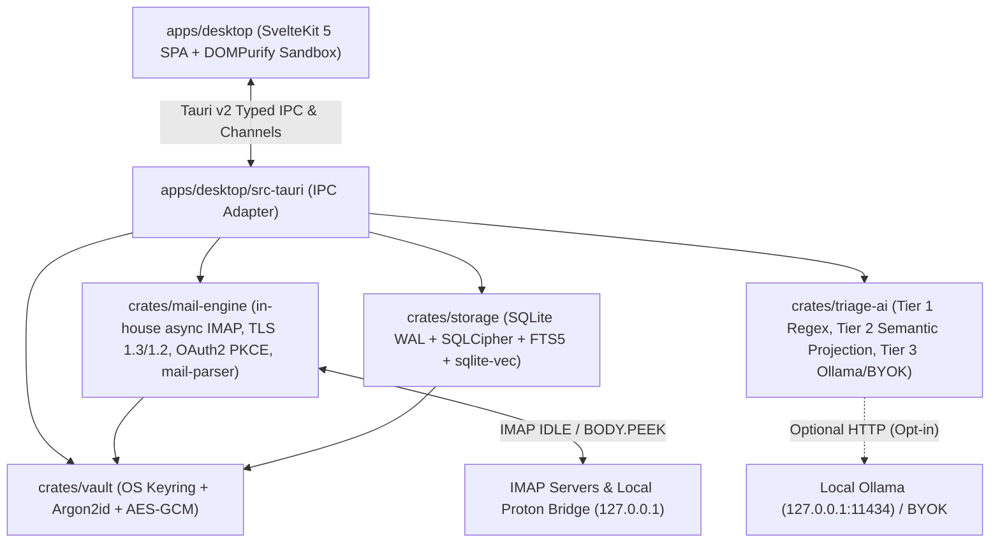

# triage-mail

**100% Local-First, Provider-Agnostic Email Aggregator and Triage Engine built with Rust, Tauri v2, SQLite (SQLCipher + FTS5 + sqlite-vec), and SvelteKit 5.**

**[English](README.md)** | **[Português (Brasil)](README.pt-br.md)**

[](https://github.com/ye-sandbox/triage-mail/actions/workflows/ci.yml)


---

## Overview

`triage-mail` is an inbound-focused email unification, hybrid search, and automated triage engine designed for users managing multiple accounts across Gmail, Outlook/Microsoft 365, Yahoo, iCloud, Proton Mail Bridge, and custom IMAP domains. Rather than acting as a bloated legacy suite, it focuses strictly on high-throughput unified reading, instant retrieval, and local-first extraction.

All credentials, message bodies, and semantic indices reside exclusively on the user's machine under encryption at rest, with zero telemetry and zero external sidecar runtimes:

- **Native Binary & Low Footprint:** Pure Rust (`tokio`) + Tauri v2 + SvelteKit 5 SPA (lean native desktop binary with zero Electron/Node/Python backend processes).
- **High-Performance Hybrid Search:** Combines configurable lexical exact match via SQLite `FTS5` (default `unicode61 remove_diacritics 2`, optional `trigram`) and local semantic vector KNN via embedded `sqlite-vec` (`int8` quantized with pre-filtering; $\le 15$ms filtered semantic p95, ~52ms global hybrid p50 across 100k messages, ADR-008).
- **Virtualized Unified Inbox:** Engineered to scroll through `100k+` messages with bounded memory ($\le 18$ DOM rows mounted), keyboard-first triage (`Command Palette`), incremental `UIDVALIDITY`/`CONDSTORE` sync, and two-way IMAP flag synchronization.
- **Transparent Multi-Mode Authentication:** Supports App Passwords, OAuth2 Public PKCE, user-supplied BYO OAuth (`client_id`/`client_secret` stored in the OS vault), standard IMAP (TLS 1.3 and TLS 1.2), and local Proton Mail Bridge behind an agnostic `ImapConnector`.
- **3-Tier Local-First AI Pipeline:**
  - *Tier 1 (Deterministic, Zero Cost):* Native Rust regex and heuristics for instant extraction of 2FA/OTP codes, FEBRABAN Boletos (with deterministic BRL amount and due date extraction), Pix EMV/keys, NF-e metadata, package tracking numbers, `List-Unsubscribe` + RFC 8058 One-Click Unsubscribe (`List-Unsubscribe-Post`), and automatic categorization (`Financial`, `Security`, `Newsletter`, `Personal`).
  - *Tier 2 (Experimental Local CPU Semantic Projection):* Deterministic token and n-gram feature-hash projections (`int8[384]`) seeded from model headers or offline constants for `sqlite-vec`; learned neural ONNX model inference is planned for v0.2.
  - *Tier 3 (Optional Generative LLM):* On-demand thread summarization via local Ollama (`http://127.0.0.1:11434`) or explicit BYOK cloud providers.
- **Zero-Knowledge Security & Safe Rendering:** OS Keyring integration (`keyring` + `argon2` fallback vault), full-database SQLCipher AES-256 storage, lazy attachment fetching (`IMAP BODY.PEEK` on demand), and strict HTML sanitization (`DOMPurify` inside `<iframe sandbox="">` with normalized dark-mode CSS and remote tracking pixels blocked by default).

## Architecture

The repository is structured as a modular Cargo Workspace so the core Rust crates (`mail-engine`, `storage`, `vault`, `triage-ai`) remain completely decoupled from the GUI and can run headless in a CLI or container:



## Status & Known Limitations

`triage-mail` is an MVP (v0.1.0) inbound email and triage engine with the following empirical performance bounds and architectural scope limits:

- **Search Latency Target Bounds (ADR-008):** At 100,000 messages on reference hardware (AMD Ryzen 7 7700), observed warm p95 latencies are: partition-filtered semantic $\le 15$ ms (12.9 ms), lexical search $\le 40$ ms (37.3 ms), global exact semantic $\le 50$ ms (47.8 ms), and parallel hybrid search $\le 60$ ms (52.4 ms p50). Global exact vector scans over 100k items stream 38.4 MB of raw `int8[384]` embeddings through SQLCipher AES-256 decryption; sub-15ms global vector search is physically infeasible on CPU without lossy approximations. Sub-15ms candidate pre-filtering via 1-bit scalar quantization (Hamming distance POPCNT) is scheduled for evaluation in v0.2.
- **Native Display & Virtual Scrolling:** The virtualized message list maintains a bounded DOM footprint ($\le 18$ mounted rows) across 100k messages. Native WebKitGTK frame callback intervals observed p95 at ~23ms under Linux/WSL. Hardware-accelerated 60fps presentation depends on local GPU and display compositor drivers and is not guaranteed across all Linux environments.
- **Tier 2 Semantic Search:** Tier 2 currently uses experimental deterministic feature-hash projections (`int8[384]`) seeded from model configuration. Neural ONNX embedding runtime integration is deferred to v0.2.
- **In-House IMAP Client (ADR-009):** IMAP communication uses an in-house asynchronous client built on `tokio` and `tokio-rustls` (supporting TLS 1.3 and TLS 1.2, with loopback certificate pinning for Proton Mail Bridge), replacing `async-imap` to enforce `#![forbid(unsafe_code)]` and zero-download lazy body fetches via RFC 3501 `BODYSTRUCTURE`.
- **Inbound-Only Scope:** MVP v0.1 focuses strictly on inbound email synchronization, local reading, search, and triage. Outbound composition and SMTP transmission are deferred to v0.2.
- **Multi-Folder Sync Scope:** Synchronization indexes standard folders (INBOX, Archive, Trash) with two-phase text-part fetching. Binary attachments are fetched on demand via `IMAP BODY.PEEK[<part_id>]`.

## Quickstart

### Prerequisites

- **Rust Toolchain:** `rustup` (`stable`, Rust 2021/2024 edition) + platform system libraries for Tauri v2 (`libwebkit2gtk-4.1-dev`, `libsecret-1-dev` on Linux).
- **Node.js & Package Manager:** Node.js `24.19.0` and `pnpm 11.25.0` (matching CI).

On Ubuntu 24.04, install the native build prerequisites (also used by CI):

```bash
sudo apt-get update
sudo apt-get install --no-install-recommends -y \
  build-essential pkg-config perl libssl-dev libwebkit2gtk-4.1-dev \
  libgtk-3-dev libsecret-1-dev libayatana-appindicator3-dev librsvg2-dev
```

### Setup & Verification

```bash
# 1. Copy development environment defaults
cp .env.example .env

# 2. Install frontend dependencies
pnpm install --frozen-lockfile

# 3. Verify Rust workspace compilation and unit tests
cargo test --workspace

# 4. Start the frontend; in another terminal run cargo run --package triage-mail-desktop
pnpm --filter desktop dev --port 1420
```

## Configuration

Runtime credentials and database encryption keys are stored strictly in the operating system keyring (`crates/vault`), never in plaintext configuration files. The `.env.example` file defines optional development overrides:

| Variable | Description | Default | Required |
| :--- | :--- | :--- | :--- |
| `RUST_LOG` | Tracing filter directives for Rust crates | `info,triage_mail=debug,mail_engine=info,storage=info` | No |
| `TRIAGE_DB_PATH` | Development override path for local SQLCipher database | `./.agent/scratch/dev-triage.db` | No |
| `TRIAGE_EMBEDDING_MODEL` | Model identifier for Tier 2 artifact caching and seed resolution | `all-MiniLM-L6-v2` | No |
| `OLLAMA_BASE_URL` | Local Ollama HTTP endpoint for Tier 3 on-demand summaries | `http://127.0.0.1:11434` | No |
| `OLLAMA_MODEL` | Default local Ollama model tag | `qwen2.5:3b` | No |
| `PROTON_BRIDGE_HOST` | Local loopback address for Proton Mail Bridge IMAP | `127.0.0.1` | No |
| `PROTON_BRIDGE_PORT` | Local loopback port for Proton Mail Bridge IMAP | `1143` | No |

## Account Setup and Authentication Guide

`triage-mail` supports four authentication methods behind an agnostic IMAP transport. Major providers block standard account passwords over IMAP; select the appropriate method below based on your provider.

### Provider discovery

Enter an email address and leave the field to look up built-in provider settings locally.
Presets cover Gmail, Microsoft consumer domains, Yahoo, iCloud, Fastmail, Zoho,
UOL, BOL, and Terra. Custom and organization domains may need manual settings;
a matching preset does not verify an account or guarantee IMAP access on its plan.

**Look up settings online** explicitly sends only the domain to Mozilla Thunderbird
ISPDB over HTTPS, with a three-second timeout and a 64 KiB response limit. It never
sends the full address, password, or OAuth credentials. Only implicit-TLS IMAP
settings are accepted. No automatic host probing occurs. **Confirm and test**
connects only to the displayed public host on port 993, verifies TLS and the IMAP
greeting, and sends no credentials. A successful probe does not verify sign-in.

Use **Advanced connection settings** for manual host/port, BYO OAuth, or Proton
Bridge configuration. Manual edits and preset selections prevent automatic lookup
from overwriting the form. Gmail has a direct App Passwords link. **Set up Microsoft
sign-in** fills Microsoft PKCE settings; supply your own registered desktop client ID,
then select **Authorize and connect**. No application ID or secret is bundled.

### Authentication Methods Overview

| Method | Best For | Prerequisites | Compatible Services |
| :--- | :--- | :--- | :--- |
| **App Password** | Fast, simple setup without developer accounts | Two-Factor Authentication (2FA) enabled on email account; IMAP enabled | Gmail, Google Workspace, iCloud, Yahoo, AOL, Fastmail, Outlook, custom IMAP |
| **OAuth · Public PKCE** | Modern browser login without storing client secrets | Provider supports RFC 7636 PKCE with `127.0.0.1` loopback redirect | Microsoft 365, Outlook.com, Hotmail, standard OIDC providers |
| **OAuth · BYO Credentials** | Continuous OAuth token flow for Google / enterprise | Developer project with `client_id` and `client_secret` (Desktop client) | Google / Gmail (via GCP Console), private enterprise SSO (Keycloak, Okta) |
| **Proton Mail Bridge** | End-to-end encrypted Proton Mail accounts | Paid Proton account + official Proton Mail Bridge app running locally | Proton Mail exclusively |

### Provider Configuration Details

#### Google / Gmail
- **Recommended (App Password):**
  1. Enable 2-Step Verification in [Google Account Security](https://myaccount.google.com/security).
  2. Visit [App Passwords](https://myaccount.google.com/apppasswords), generate a 16-character password (e.g. named `Triage Mail`).
  3. Ensure IMAP is enabled in Gmail settings (*See all settings $\rightarrow$ Forwarding and POP/IMAP $\rightarrow$ Enable IMAP*).
  4. In `triage-mail`, select **App password**: Host `imap.gmail.com`, Port `993`, and paste the 16-character password.
- **Alternative (BYO OAuth):**
  1. Create a project in [Google Cloud Console](https://console.cloud.google.com/).
  2. Configure OAuth Consent Screen (External, add scope `https://mail.google.com/`).
  3. Create Credentials $\rightarrow$ OAuth Client ID $\rightarrow$ Application type **Desktop app**.
  4. In `triage-mail`, select **OAuth · Your client credentials**:
     - Authorization endpoint: `https://accounts.google.com/o/oauth2/v2/auth`
     - Token endpoint: `https://oauth2.googleapis.com/token`
     - Scopes: `https://mail.google.com/`
     - Client ID & Client Secret from GCP.

#### Microsoft (Outlook.com / Hotmail / Microsoft 365)
- **Recommended (OAuth · Public PKCE):**
  1. In `triage-mail`, select **OAuth · Public PKCE**.
  2. Host: `outlook.office365.com`, Port: `993`.
  3. Authorization endpoint: `https://login.microsoftonline.com/common/oauth2/v2.0/authorize`
  4. Token endpoint: `https://login.microsoftonline.com/common/oauth2/v2.0/token`
  5. Scopes: `offline_access https://outlook.office.com/IMAP.AccessAsUser.All`
  6. Client ID: Public Microsoft Application ID registered for desktop PKCE.
- **Alternative (App Password):**
  1. If two-step verification is enabled on your Microsoft account, create an app password under *Advanced security options*.
  2. In `triage-mail`, select **App password**: Host `outlook.office365.com`, Port `993`.

#### Apple iCloud Mail
1. Enable two-factor authentication on your Apple ID.
2. Sign in to [appleid.apple.com](https://appleid.apple.com) and go to *Sign-In and Security $\rightarrow$ App-Specific Passwords*.
3. Generate a password for `triage-mail`.
4. In `triage-mail`, select **App password**:
   - Host: `imap.mail.me.com`
   - Port: `993`
   - Email: your iCloud email address
   - Secret: the app-specific password.

#### Yahoo Mail & AOL
1. Go to *Account Info $\rightarrow$ Account Security*.
2. Scroll to *Generate app password* and select *Other app* $\rightarrow$ name it `triage-mail`.
3. In `triage-mail`, select **App password**:
   - Host: `imap.mail.yahoo.com` (or `imap.aol.com` for AOL)
   - Port: `993`
   - Secret: the 16-character generated app password.

#### Proton Mail (via Proton Mail Bridge)
1. Ensure you have an active paid Proton subscription (required by Proton for Bridge access).
2. Download, install, and open the official **Proton Mail Bridge** application on your machine.
3. Add your Proton account inside the Bridge and wait for local synchronization.
4. In Bridge settings, verify that IMAP is set to SSL/TLS (default port `1143`).
5. Open the account drawer in Proton Mail Bridge to view your **Bridge Username** and **Bridge Password**.
6. In `triage-mail`, select **Proton Mail Bridge**:
   - Host: `127.0.0.1` (strictly loopback)
   - Port: `1143`
   - Username: Bridge username (as shown in Bridge)
   - Bridge password: the password generated by Bridge (*never* your master Proton account password).

#### Custom / Self-Hosted IMAP (Dovecot, Postfix, Zimbra, cPanel)
1. In `triage-mail`, select **App password**.
2. Enter your full email address, IMAP server hostname (e.g., `mail.example.org`), and TLS port (`993`).
3. Enter your account password or dedicated application token.

## Usage

```bash
# Run headless core crate tests (MIME parsing, deterministic 2FA/Boleto triage, storage)
cargo test --workspace

# Build the SPA, then the native desktop binary (no installer packaging)
pnpm --filter desktop build
cargo build --release --package triage-mail-desktop
```

### Local rules and automatic filters

Open **Settings → Rules** to create, edit, disable or reorder local filters. The message
action **Create rule from message** prefills account and sender in an unsaved draft.
Choose all/any/except conditions and tag, star or archive actions; enable the rule before
saving. Text matching ignores case; sender domains match exactly unless subdomains are
explicitly selected. Amounts use integer BRL cents and dates use `YYYY-MM-DD`.

Rules run in displayed order on new arrivals after each folder's initial history baseline.
A matching stop rule skips later rules; duplicate actions coalesce. Initial imports and
UIDVALIDITY rebuilds do not trigger rules. Saving or enabling a rule never changes old
mail. Select an inbox message and use **Simulate selected messages** to inspect matches
and planned actions without changing mail. Missing cached facts never match positive
conditions, attachment bytes are never fetched, and a sender match does not authenticate
identity. Processing requires the app to be running. Alert destinations can also be selected
as rule actions after configuration.

### Local notifications and webhook alerts

Open **Settings → Alerts** to add a destination. Destinations start disabled. Local notices
are generic and may appear on the lock screen; this build uses the Linux desktop notification
service and reports unavailable/denied service explicitly. Other operating systems currently
report unavailable. Webhooks accept public DNS HTTPS endpoints on port 443, including public
user-owned n8n workflows; private-network, loopback, IP-literal and HTTP endpoints are unsupported.
Complete URLs and optional bearer credentials are stored only in vault; lists show public origins.

Select exported fields and confirm the displayed destination before enabling it, then choose
it in a rule. Defaults contain only schema version, opaque event ID, event timestamp and
truncation status. Sender, subject, account ID, excerpt, boleto amounts/dates, attachment
metadata and plain-text body each require selection. Body/excerpt may expose verification
or payment data. Body export is limited to 6,000 UTF-8 bytes, excerpts to 512 bytes, metadata
collections to 16 entries and JSON to 64 KiB; truncation is explicit. HTML, raw headers,
attachment bytes and raw OTP/Pix extraction values are excluded. Missing content is never fetched.

**Test delivery** sends a synthetic event only after confirmation. **Replay selected messages**
requires explicit message/destination selection and confirmation; it sends current selected
fields without applying mail actions. Simulation never sends. Initial history never alerts.
Changing/disablement cancels pending destination revisions; enabling never replays canceled work.
Deleting a message/account cancels its pending alerts, including cache deletion after some moves.

Keep the app active and unlocked for processing; a runnable headless CLI is future work.
Retries use stable event IDs/Idempotency-Key, bounded backoff and rate limits (six starts/minute
per destination), with at most eight attempts/24 hours. Timeouts/crashes can produce duplicates;
receivers should deduplicate by event ID. Accepted means receiver/service acceptance, not human
visibility. Disabling waits for an already-started request (at most ten seconds), which cannot
be recalled. Execution history contains safe statuses/counts/times, retained up to 30 days and
1,000 records per destination. Completed payloads are cleared. No live test is sent automatically.

## Development

### Repository Structure

```text
.
├── .agent/                   # ADD governance, active contracts (NOTES.md), and task roadmap (TASK.md)
├── apps/
│   └── desktop/              # SvelteKit 5 SPA frontend + Tauri v2 (src-tauri) entrypoint
├── crates/
│   ├── mail-engine/          # Async IMAP, OAuth2 PKCE loopback, IDLE manager, RFC 5322 MIME parser
│   ├── storage/              # SQLite WAL + SQLCipher, migrations, FTS5, and sqlite-vec
│   ├── triage-ai/            # Tier 1 Regex (2FA/Boletos/Tracking), Tier 2 Semantic Projection, Tier 3 LLM client
│   └── vault/                # OS Keyring integration and Argon2id + AES-GCM cryptography
├── docs/
│   └── adr/                  # Architectural Decision Records (decisions.md)
├── AGENTS.md                 # Engineering rules, invariants, and Definition of Done
├── Cargo.toml                # Rust Cargo Workspace manifest
└── package.json              # Frontend workspace manifest
```

### Validation Commands

The [CI workflow](.github/workflows/ci.yml) runs on pull requests, pushes to `main`,
and manual dispatch, using Ubuntu 24.04, Rust 1.99.0 with rustfmt/Clippy, Node.js 24.19.0
and pnpm 11.25.0. Actions are pinned to commit hashes; checkout credentials are not persisted.
Dependency installation needs package/toolchain registries and Ubuntu repositories. Rust
validation runs offline after `cargo fetch --locked`; tests use synthetic fixtures and local
loopback servers without provider credentials or model downloads. CI does not publish artifacts.

The dependency-free policy scanner reads tracked working-tree text files, permits reserved
example/test domains, rejects other mailbox addresses and selected high-signal secret formats,
and checks Svelte components/rune modules for legacy syntax. It prints locations and rule names
without matched values. It is a bounded guard, not an exhaustive secret or Git-history audit;
review credential changes manually. New files must be staged before a local scan.

```bash
# Rust Workspace checks
cargo check --workspace
cargo test --workspace
cargo fmt --all -- --check
cargo clippy --workspace --all-targets -- -D warnings

# Frontend (apps/desktop) checks
pnpm --filter desktop check
pnpm --filter desktop test
pnpm --filter desktop build

node --test scripts/ci-guard.test.mjs
node scripts/ci-guard.mjs
git diff --check
```

Optional synthetic performance validation covers 100,000-row SQLCipher search and a separate
native WebKitGTK inbox fixture, with frame timing and process-tree memory sampling. See
[methodology, commands and measured limits](docs/performance/native-validation.md).
These tools do not contact providers or download models; rebuild the ordinary SPA after the
fixture build before producing an application binary.
Mailbox-specific correctness and latency validation uses
`cargo run --offline --release -p storage --example mailbox_performance`.
See the [mailbox validation report](docs/performance/mailbox-validation.md) for scoped
workloads, native IPC timings, screenshots, and remaining acceptance gaps.

The binary-candidate investigation uses the same encrypted mailbox fixture:
`cargo run --offline --release -p storage --example binary_quantization`.
Run its adversarial probes with `cargo test --offline -p storage --example binary_quantization`.
See the [binary quantization evaluation](docs/performance/binary-quantization.md) for
candidate budgets, oracle equivalence and the adoption decision.

## License

Licensed under the **GNU Affero General Public License v3.0 (AGPLv3)** — see [`LICENSE`](LICENSE) for details.
