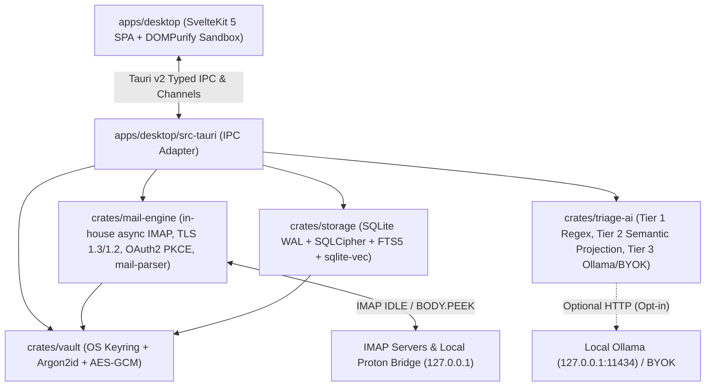

# triage-mail

**100% Local-First, Provider-Agnostic Email Aggregator and Triage Engine built with Rust, Tauri v2, SQLite (SQLCipher + FTS5 + sqlite-vec), and SvelteKit 5.**

**[English](README.md)** | **[Português (Brasil)](README.pt-br.md)**

[](https://github.com/ye-sandbox/triage-mail/actions/workflows/ci.yml)


---

## Overview

`triage-mail` is an inbound-focused email unification, hybrid search, and automated triage engine designed for users managing multiple accounts across Gmail, Outlook/Microsoft 365, Yahoo, iCloud, Proton Mail Bridge, and custom IMAP domains. Rather than acting as a bloated legacy suite, it focuses strictly on high-throughput unified reading, instant retrieval, and local-first extraction.

All credentials, message bodies, and semantic indices reside exclusively on the user's machine under encryption at rest, with zero telemetry and zero external sidecar runtimes:

- **Native Binary & Low Footprint:** Pure Rust (`tokio`) + Tauri v2 + SvelteKit 5 SPA (lean native desktop binary with zero Electron/Node/Python backend processes).
- **High-Performance Hybrid Search:** Combines configurable lexical exact match via SQLite `FTS5` (default `unicode61 remove_diacritics 2`, optional `trigram`) and local semantic vector KNN via embedded `sqlite-vec` (`int8` quantized with pre-filtering; $\le 15$ms filtered semantic p95, ~52ms global hybrid p50 across 100k messages, ADR-008).
- **Virtualized Unified Inbox:** Engineered to scroll through `100k+` messages with bounded memory ($\le 18$ DOM rows mounted), keyboard-first triage (`Command Palette`), incremental `UIDVALIDITY`/`CONDSTORE` sync, and two-way IMAP flag synchronization.
- **Transparent Multi-Mode Authentication:** Supports App Passwords, OAuth2 Public PKCE, user-supplied BYO OAuth (`client_id`/`client_secret` stored in the OS vault), standard IMAP (TLS 1.3 and TLS 1.2), and local Proton Mail Bridge behind an agnostic `ImapConnector`.
- **3-Tier Local-First AI Pipeline:**
  - *Tier 1 (Deterministic, Zero Cost):* Native Rust regex and heuristics for instant extraction of 2FA/OTP codes, FEBRABAN Boletos (with deterministic BRL amount and due date extraction), Pix EMV/keys, NF-e metadata, package tracking numbers, `List-Unsubscribe` + RFC 8058 One-Click Unsubscribe (`List-Unsubscribe-Post`), and automatic categorization (`Financial`, `Security`, `Newsletter`, `Personal`).
  - *Tier 2 (Local CPU ONNX Embeddings):* Opt-in learned MiniLM inference with verified, separately installed model/runtime files and generation-safe `int8[384]` indexing for `sqlite-vec`.
  - *Tier 3 (Optional Generative LLM):* On-demand thread summarization via local Ollama (`http://127.0.0.1:11434`) or explicit BYOK cloud providers.
- **Due-Date Dashboard & Scheduled Reminders:** Extracted FEBRABAN boletos and invoices automatically populate a dedicated due-date dashboard with 1-click barcode copy, status breakdowns (Overdue, Due Today, Upcoming), non-payment disclaimers, and configurable scheduled reminders (days before deadline or unread duration) dispatched locally or via external destinations (Webhooks, Telegram, Discord).
- **Zero-Knowledge Security & Safe Rendering:** OS Keyring integration (`keyring` + `argon2` fallback vault), full-database SQLCipher AES-256 storage, lazy attachment fetching (`IMAP BODY.PEEK` on demand), and strict HTML sanitization (`DOMPurify` inside `<iframe sandbox="">` with normalized dark-mode CSS and remote tracking pixels blocked by default).

## Architecture

The repository is structured as a modular Cargo Workspace so the core Rust crates (`mail-engine`, `storage`, `vault`, `triage-ai`) remain completely decoupled from the GUI and can run headless in a CLI or container:



## Status & Known Limitations

`triage-mail` is an MVP (v0.1.0) inbound email and triage engine with the following empirical performance bounds and architectural scope limits:

- **Search Latency Target Bounds (ADR-008):** At 100,000 messages on reference hardware (AMD Ryzen 7 7700), observed warm p95 latencies are: partition-filtered semantic $\le 15$ ms (12.9 ms), lexical search $\le 40$ ms (37.3 ms), global exact semantic $\le 50$ ms (47.8 ms), and parallel hybrid search $\le 60$ ms (52.4 ms p50). Global exact vector scans over 100k items stream 38.4 MB of raw `int8[384]` embeddings through SQLCipher AES-256 decryption; sub-15ms global vector search is physically infeasible on CPU without lossy approximations. Sub-15ms candidate pre-filtering via 1-bit scalar quantization (Hamming distance POPCNT) is scheduled for evaluation in v0.2.
- **Native Display & Virtual Scrolling:** The virtualized message list maintains a bounded DOM footprint ($\le 18$ mounted rows) across 100k messages. Native WebKitGTK frame callback intervals observed p95 at ~23ms under Linux/WSL. Hardware-accelerated 60fps presentation depends on local GPU and display compositor drivers and is not guaranteed across all Linux environments.
- **Tier 2 Semantic Search:** Native MiniLM CPU inference replaces projections in the desktop. Semantic search requires explicit enablement, verified model/runtime files and a complete compatible local index; word search remains available during rebuilds.
- **In-House IMAP Client (ADR-009):** IMAP communication uses an in-house asynchronous client built on `tokio` and `tokio-rustls` (supporting TLS 1.3 and TLS 1.2, with loopback certificate pinning for Proton Mail Bridge), replacing `async-imap` to enforce `#![forbid(unsafe_code)]` and zero-download lazy body fetches via RFC 3501 `BODYSTRUCTURE`.
- **Inbound-Only Scope:** MVP v0.1 focuses strictly on inbound email synchronization, local reading, search, and triage. Outbound composition and SMTP transmission are deferred to v0.2.
- **Multi-Folder Sync Scope:** Synchronization indexes standard folders (INBOX, Archive, Trash) with two-phase text-part fetching. Binary attachments are fetched on demand via `IMAP BODY.PEEK[<part_id>]`.

## Quickstart

### Prerequisites

- **Rust Toolchain:** `rustup` (`stable`, Rust 2021/2024 edition) + platform system libraries for Tauri v2 (`libwebkit2gtk-4.1-dev`, `libsecret-1-dev` on Linux).
- **Node.js & Package Manager:** Node.js `24.19.0` and `pnpm 11.25.0` (matching CI).

On Ubuntu 24.04, install the native build prerequisites (also used by CI):

```bash
sudo apt-get update
sudo apt-get install --no-install-recommends -y \
  build-essential pkg-config perl libssl-dev libwebkit2gtk-4.1-dev \
  libgtk-3-dev libsecret-1-dev libayatana-appindicator3-dev librsvg2-dev
```

### Setup & Verification

```bash
# 1. Copy development environment defaults
cp .env.example .env

# 2. Install frontend dependencies
pnpm install --frozen-lockfile

# 3. Verify Rust workspace compilation and unit tests
cargo test --workspace

# 4. Start the frontend; in another terminal run cargo run --package triage-mail-desktop
pnpm --filter desktop dev --port 1420
```

## Configuration

Runtime credentials and database encryption keys are stored strictly in the operating system keyring (`crates/vault`), never in plaintext configuration files. The `.env.example` file defines optional development overrides:

| Variable | Description | Default | Required |
| :--- | :--- | :--- | :--- |
| `RUST_LOG` | Tracing filter directives for Rust crates | `info,triage_mail=debug,mail_engine=info,storage=info` | No |
| `TRIAGE_DB_PATH` | Development override path for local SQLCipher database | `./.agent/scratch/dev-triage.db` | No |
| `TRIAGE_EMBEDDING_MODEL` | Reserved development model example; desktop pins `all-MiniLM-L6-v2` | `all-MiniLM-L6-v2` | No |
| `OLLAMA_BASE_URL` | Local Ollama HTTP endpoint for Tier 3 on-demand summaries | `http://127.0.0.1:11434` | No |
| `OLLAMA_MODEL` | Default local Ollama model tag | `qwen2.5:3b` | No |
| `PROTON_BRIDGE_HOST` | Local loopback address for Proton Mail Bridge IMAP | `127.0.0.1` | No |
| `PROTON_BRIDGE_PORT` | Local loopback port for Proton Mail Bridge IMAP | `1143` | No |

## Account Setup and Authentication Guide

`triage-mail` supports four authentication methods behind an agnostic IMAP transport. Major providers block standard account passwords over IMAP; select the appropriate method below based on your provider.

### Provider discovery

Enter an email address and leave the field to look up built-in provider settings locally.
Presets cover Gmail, Microsoft consumer domains, Yahoo, iCloud, Fastmail, Zoho (US/EU),
GMX, Mail.com, AOL, Yandex, UOL, BOL, Terra, and Proton (via Bridge). Custom and organization domains may need manual settings;
a matching preset does not verify an account or guarantee IMAP access on its plan.

**Look up settings online** explicitly sends only the domain to Mozilla Thunderbird
ISPDB over HTTPS, with a three-second timeout and a 64 KiB response limit. It never
sends the full address, password, or OAuth credentials. Only implicit-TLS IMAP
settings are accepted. No automatic host probing occurs. **Confirm and test**
connects only to the displayed public host on port 993, verifies TLS and the IMAP
greeting, and sends no credentials. A successful probe does not verify sign-in.

**Detect via DNS** is a separate button that resolves only the MX records of the
typed domain (three-second deadline, at most 10 records, never the local part). It
only selects a Google Workspace or Microsoft 365 preset and never runs automatically.

Use **Advanced connection settings** for manual host/port, BYO OAuth, or Proton
Bridge configuration. Manual edits and preset selections prevent automatic lookup
from overwriting the form. Gmail has a direct App Passwords link. **Set up Microsoft
sign-in** fills Microsoft PKCE settings; supply your own registered desktop client ID,
then select **Authorize and connect**. No application ID or secret is bundled.

### Authentication Methods Overview

| Method | Best For | Prerequisites | Compatible Services |
| :--- | :--- | :--- | :--- |
| **App Password** | Fast, simple setup without developer accounts | Two-Factor Authentication (2FA) enabled on email account; IMAP enabled | Gmail, Google Workspace, iCloud, Yahoo, AOL, Fastmail, Outlook, custom IMAP |
| **OAuth · Public PKCE** | Modern browser login without storing client secrets | Provider supports RFC 7636 PKCE with `127.0.0.1` loopback redirect | Microsoft 365, Outlook.com, Hotmail, standard OIDC providers |
| **OAuth · BYO Credentials** | Continuous OAuth token flow for Google / enterprise | Developer project with `client_id` and `client_secret` (Desktop client) | Google / Gmail (via GCP Console), private enterprise SSO (Keycloak, Okta) |
| **Proton Mail Bridge** | End-to-end encrypted Proton Mail accounts | Paid Proton account + official Proton Mail Bridge app running locally | Proton Mail exclusively |

The add-account form shows a compact recommendation card for the detected provider (Gmail → App Password, Outlook → Microsoft sign-in, Proton → Bridge, unknown domains → manual IMAP) and collapses the remaining methods under "More sign-in methods".

### Provider Configuration Details

#### Google / Gmail
- **Recommended (App Password):**
  1. Enable 2-Step Verification in [Google Account Security](https://myaccount.google.com/security).
  2. Visit [App Passwords](https://myaccount.google.com/apppasswords), generate a 16-character password (e.g. named `Triage Mail`).
  3. Ensure IMAP is enabled in Gmail settings (*See all settings $\rightarrow$ Forwarding and POP/IMAP $\rightarrow$ Enable IMAP*).
  4. In `triage-mail`, select **App password**: Host `imap.gmail.com`, Port `993`, and paste the 16-character password. Spaces in the password as Google displays it are removed automatically, and a hint appears if the value does not look like an App Password.
- **Alternative (BYO OAuth):**
  1. Create a project in [Google Cloud Console](https://console.cloud.google.com/).
  2. Configure OAuth Consent Screen (External, add scope `https://mail.google.com/`).
  3. Create Credentials $\rightarrow$ OAuth Client ID $\rightarrow$ Application type **Desktop app**.
  4. In `triage-mail`, select **OAuth · Your client credentials**:
     - Authorization endpoint: `https://accounts.google.com/o/oauth2/v2/auth`
     - Token endpoint: `https://oauth2.googleapis.com/token`
     - Scopes: `https://mail.google.com/`
     - Client ID & Client Secret from GCP.
  5. While the consent screen is in *Testing* mode, Google expires refresh tokens after 7 days. Publish it **In production** (free for personal use) to avoid weekly re-authorization.

#### Microsoft (Outlook.com / Hotmail / Microsoft 365)
- **Recommended (OAuth · Public PKCE):**
  1. In `triage-mail`, select **OAuth · Public PKCE**.
  2. Host: `outlook.office365.com`, Port: `993`.
  3. Authorization endpoint: `https://login.microsoftonline.com/common/oauth2/v2.0/authorize`
  4. Token endpoint: `https://login.microsoftonline.com/common/oauth2/v2.0/token`
  5. Scopes: `offline_access https://outlook.office.com/IMAP.AccessAsUser.All`
  6. Client ID: Public Microsoft Application ID registered for desktop PKCE.
- **Alternative (App Password):**
  1. If two-step verification is enabled on your Microsoft account, create an app password under *Advanced security options*.
  2. In `triage-mail`, select **App password**: Host `outlook.office365.com`, Port `993`.

#### Apple iCloud Mail
1. Enable two-factor authentication on your Apple ID.
2. Sign in to [appleid.apple.com](https://appleid.apple.com) and go to *Sign-In and Security $\rightarrow$ App-Specific Passwords*.
3. Generate a password for `triage-mail`.
4. In `triage-mail`, select **App password**:
   - Host: `imap.mail.me.com`
   - Port: `993`
   - Email: your iCloud email address
   - Secret: the app-specific password.

#### Yahoo Mail & AOL
1. Go to *Account Info $\rightarrow$ Account Security*.
2. Scroll to *Generate app password* and select *Other app* $\rightarrow$ name it `triage-mail`.
3. In `triage-mail`, select **App password**:
   - Host: `imap.mail.yahoo.com` (or `imap.aol.com` for AOL)
   - Port: `993`
   - Secret: the 16-character generated app password.

#### Proton Mail (via Proton Mail Bridge)
1. Ensure you have an active paid Proton subscription (required by Proton for Bridge access).
2. Download, install, and open the official **Proton Mail Bridge** application on your machine.
3. Add your Proton account inside the Bridge and wait for local synchronization.
4. In Bridge settings, verify that IMAP is set to SSL/TLS (default port `1143`).
5. Open the account drawer in Proton Mail Bridge to view your **Bridge Username** and **Bridge Password**.
6. In `triage-mail`, select **Proton Mail Bridge**:
   - Host: `127.0.0.1` (strictly loopback)
   - Port: `1143`
   - Username: Bridge username (as shown in Bridge)
   - Bridge password: the password generated by Bridge (*never* your master Proton account password).

#### Custom / Self-Hosted IMAP (Dovecot, Postfix, Zimbra, cPanel)
1. In `triage-mail`, select **App password**.
2. Enter your full email address, IMAP server hostname (e.g., `mail.example.org`), and TLS port (`993`).
3. Enter your account password or dedicated application token.

## Usage

```bash
# Run headless core crate tests (MIME parsing, deterministic 2FA/Boleto triage, storage)
cargo test --workspace

# Build the SPA, then the native desktop binary (no installer packaging)
pnpm --filter desktop build
cargo build --release --package triage-mail-desktop
```

### Offline cached-mail CLI

Build a GUI-free executable and inspect an existing encrypted cache:

```bash
cargo build --release --locked -p triage-mail-cli
target/release/triage-mail-cli --data-dir /path/to/triage-mail accounts
target/release/triage-mail-cli --data-dir /path/to/triage-mail search --query boleto --limit 20
target/release/triage-mail-cli --data-dir /path/to/triage-mail show --message-id msg-a
cargo test --locked -p triage-mail-cli
```

Keys remain in the existing vault. For fallback unlock, add `--unlock-stdin` and pipe
the passphrase from a trusted password manager or private file descriptor; terminal
stdin is refused. Recovered installations require fallback unlock. Stdout contains
private mail as bounded JSON. The CLI accepts schema 11 only and performs local
read-only queries, without initialization, migration, sync or automation. SQLite WAL
access can require shared-memory sidecars/directory permissions. See the [CLI reference](docs/cli.md)
for output shapes, limits, exit codes and compatibility.

### Offline CLI container

On Linux x86_64, package the CLI using only cached build dependencies and host
runtime libraries; no base-image pull or dependency download is performed:

```bash
scripts/build-cli-image.sh triage-mail-cli:local
TRIAGE_CLI_TEST_IMAGE=triage-mail-cli:local cargo test --offline --locked -p triage-mail-cli --test offline container_reads_readonly_encrypted_wal_and_fails_closed -- --ignored --exact
```

The non-root `scratch` image supports the same offline commands. Use a read-only
existing-data mount, fallback passphrase through stdin, `--network=none`, disabled
Docker logs and the other restrictions in the [container instructions](docs/cli.md#linux-container-packaging).
Existing usable WAL/SHM sidecars are required; missing sidecars fail closed.
Active sync, daemon operation and automation are separate future work.

### Conversations and thread triage

Select **Conversations** above the message list to group cached mail within each account.
The default message view remains available. Grouping uses Message-ID, In-Reply-To and
References only; identical subjects do not join messages. Missing or malformed headers
can leave singletons, and ambiguous duplicate IDs never resolve links. Grouping does not
verify an author. A preparation counter appears while local history is indexed.

Rows show matching, cached and unread counts. Open a conversation to browse chronological
member pages, including explicitly labeled messages outside the active view or folder.
Open an individual member to load its body through the existing sanitized, sandboxed
reader. Attachments still download only on explicit request.

Conversation read/unread, archive and tag actions default to matching cached messages.
Select **Include all cached members** separately to include other folders or messages
outside the filter. Preview the exact account, folders and affected messages before
confirming. Confirmations expire after five minutes; changed membership or filters require
refreshing. New arrivals are excluded. Selections above 500 messages must be narrowed.
Local updates commit together; remote operations can complete or fail independently.
Pending/failed changes and attempt counts appear beside members while the active app
retries them. No automatic whole-conversation read or conversation unsubscribe is added.

Index consolidation and grouped ranking scan account/result metadata; large-mailbox
latency and database-lock stalls remain limitations. Conversation hybrid ranking uses
complete eligible branch rankings; existing message-mode ranking stays unchanged. Run
`cargo run --offline --release -p storage --example conversation_performance` for the
synthetic encrypted fixture. Measurements do not establish native 60fps behavior.

### New-sender review

Enable **Settings → New senders** separately for each account. Review is disabled by
default. Cached history and first-sync history seed **Known** senders; Known is not
user acceptance. Initialization runs in local batches. First synchronization of a
folder, UIDVALIDITY rebuilds and unknown UIDNEXT are conservative: arrivals during
those windows may become Known rather than Pending. Existing decisions are preserved.

Choose **New senders → Pending review** or **Declined** to inspect messages using the
normal reader and search modes. The current account selection applies across its
folders. Accept, decline or return a sender to pending after confirming the exact
address and account. Choices affect existing and future cached messages and survive
re-sync and cache removal until the account is deleted. Settings lists decisions in
pages of at most 200 senders. Missing or ambiguous sender identities stay visible and
cannot receive sender-wide choices. Matching uses the shared single-mailbox parser,
ASCII-lowercased addresses and no provider alias folding. Familiarity does not
authenticate the author.

Review-only is the default enabled mode. The separate **Hide pending and declined
senders in Inbox only** option changes local Inbox results; All Mail, other mailboxes,
categories, saved searches and review retain access. Declining never deletes mail or
blocks delivery at the provider. Rules, reminders and alerts continue independently.
Disabling immediately restores Inbox visibility; re-enabling seeds intervening history
and retains earlier decisions and pending reviews. No model, attachment fetch or network
request is needed. Search performance evidence and limitations are recorded in
[`docs/performance/sender-review.md`](docs/performance/sender-review.md).

```bash
cargo run --offline --release -p storage --example sender_review_performance
```

### Local automatic categories

Use **Local categories** in the sidebar to filter the current mailbox across the full
native result set. The six local categories are People, Finance, Purchases, Newsletters,
Notifications and Security. Deterministic precedence is Security, Finance, Purchases,
Newsletters, Notifications, then People as the fallback. People does not prove a human
sender; sender addresses are unauthenticated. No model download or cloud request is used.

Expand **Local categories** in the selected message to inspect the automatic result,
reason and effective source. Correct only that message, or separately confirm an exact
sender override for its account's existing and future cached mail. Message corrections
win over sender overrides, which win over automatic classification. Reset either layer
to use the next one. **Settings → Local categories** lists active sender overrides for
removal. Category changes preserve extraction badges and never move mail or run rules,
reminders or deliveries. Save current search retains the category filter.

All category metadata stays in SQLCipher. Automatic history backfill runs in resumable
batches while the unlocked app is active; views converge as that backfill completes.
Corrections survive ordinary re-sync, restart and canonical moves. After cache deletion,
restoration requires the same account-bound provider ID, or a valid Message-ID and
received timestamp. Without those, corrections last only for the cached record; the
message controls disclose this limit. Account removal deletes its category metadata.
These controls do not train a model. Offline timing and limits are recorded in
[`docs/performance/categories.md`](docs/performance/categories.md).

### Saved searches and virtual folders

Use **Saved searches** in the sidebar to create a named view, save the current search
and mailbox scope, or edit a starter for unread clients, invoices or upcoming bills.
Views support all accounts or a selected set, query text/mode, read/star/attachment
states, required tags, exact parsed sender/domain, extraction type and boleto due dates.
All filters must match. Empty account selection means all accounts; selecting accounts
never silently broadens after account removal. Edit an unavailable view to repair its
references. An existing mailbox scope can be cleared in the editor to span accounts.

Definitions stay in SQLCipher. Native search applies membership before ranking and
pagination; selecting a view never moves mail or runs rules. Sync, triage, focus/resume
and UTC midnight refresh active membership. Upcoming bills includes today through the
next 30 UTC calendar days; missing dates do not match, and extraction does not indicate
payment. Choose a sender or tag for the unread-client starter; clients are not inferred.
Sender matching does not authenticate identity. Semantic modes retain the existing
experimental opt-in and local model requirement. Edit to rename or change filters;
deleting the active view returns to All Mail. No reminder or scheduled delivery is added.
Synthetic performance results and limits are in
[`docs/performance/saved-views.md`](docs/performance/saved-views.md).

### Local rules and automatic filters

Open **Settings → Rules** to create, edit, disable or reorder local filters. The message
action **Create rule from message** prefills account and sender in an unsaved draft.
Choose all/any/except conditions and tag, star or archive actions; enable the rule before
saving. Text matching ignores case; sender domains match exactly unless subdomains are
explicitly selected. Amounts use integer BRL cents and dates use `YYYY-MM-DD`.

Rules run in displayed order on new arrivals after each folder's initial history baseline.
A matching stop rule skips later rules; duplicate actions coalesce. Initial imports and
UIDVALIDITY rebuilds do not trigger rules. Saving or enabling a rule never changes old
mail. Select an inbox message and use **Simulate selected messages** to inspect matches
and planned actions without changing mail. Missing cached facts never match positive
conditions, attachment bytes are never fetched, and a sender match does not authenticate
identity. Processing requires the app to be running. Alert destinations can also be selected
as rule actions after configuration.

### Local notifications, Telegram, Discord and webhook alerts

Open **Settings → Alerts** to add a destination. Destinations start disabled. Local notices
are generic and may appear on the lock screen; this build uses the Linux desktop notification
service and reports unavailable/denied service explicitly. Other operating systems currently
report unavailable. Webhooks accept public DNS HTTPS endpoints on port 443, including public
user-owned n8n workflows; private-network, loopback, IP-literal and HTTP endpoints are unsupported.
Complete URLs and optional bearer credentials are stored only in vault; lists show public origins.

For **Telegram**, create a bot with BotFather, start it in the intended chat (or add it to a
group/channel with posting permission), and enter its bot token and exact numeric chat ID from
your own Telegram administration tools. Chat discovery is not performed; usernames and automatic
chat migration are unsupported. Confirm the intended recipient before enabling. Tokens and chat
IDs stay in vault; configuration lists show only `https://api.telegram.org`.

For **Discord**, create a webhook under the intended channel's **Integrations → Webhooks** settings
and paste its canonical `https://discord.com/api/webhooks/…` URL. Confirm the channel in Discord;
queries, alternate hosts, thread selection and attachments are unsupported. The full secret URL
stays in vault; configuration lists show only `https://discord.com`.

Both connectors send one text message containing the selected JSON fields, with visible truncation
at conservative limits of 3,500 UTF-16 units for Telegram and 1,800 for Discord. Telegram uses plain
text with link previews disabled; Discord suppresses mentions and embeds. They do not promise
idempotency. Bounded responses supply acceptance/error codes and retry delays only; response bodies
are never logged, stored or returned. Retry outcomes persist a conservative cooldown across all
destinations of that provider, including those sharing credentials. No setup/save request contacts
a provider. Offline tests cover protocol behavior; live receiver interoperability is unverified.

Select exported fields and confirm the displayed destination before enabling it, then choose
it in a rule. Defaults contain only schema version, opaque event ID, event timestamp and
truncation status. Sender, subject, account ID, excerpt, boleto amounts/dates, attachment
metadata and plain-text body each require selection. Body/excerpt may expose verification
or payment data. Body export is limited to 6,000 UTF-8 bytes, excerpts to 512 bytes, metadata
collections to 16 entries and JSON to 64 KiB; truncation is explicit. HTML, raw headers,
attachment bytes and raw OTP/Pix extraction values are excluded. Missing content is never fetched.

In **Digests & quiet hours**, choose immediate, hourly (minute of the hour), or daily
(time of day) delivery per destination, using system local time or UTC. Quiet intervals
include their start and exclude their end, and may cross midnight. Missing DST times
advance to the first valid minute; repeated schedule times run once at the earlier
occurrence. The preview shows the next eligible time without sending.

Missed windows merge into one catch-up summary; unsent items expire after 24 hours.
Summaries retain at most 50 detailed entries within 64 KiB, with total/omitted counts;
provider text limits can truncate further. The encrypted queue holds at most 1,000
items per destination and reports overflow. A pending summary keeps its event ID,
payload and oldest item's retry deadline. Removing a constituent cancels the whole
unsent summary, including its surviving entries. Reading an unread reminder or
canceling its reminder configuration also cancels affected queued deliveries.

**Urgent alert** rule actions bypass digests/quiet hours only after separate permission
in that destination's scheduling policy. Otherwise they follow the routine schedule;
reminders are always routine. Rate limits and field consent still apply. Policy changes
cancel prior automatic work. Backward clock/timezone changes conservatively expire
already-closed civil slots rather than replaying them. Explicit test/replay confirmation
discloses that it bypasses scheduling, without flushing queued routine items.

**Test delivery** sends a synthetic event only after confirmation. **Replay selected messages**
requires explicit message/destination selection and confirmation; it sends current selected
fields without applying mail actions. Simulation never sends. Initial history never alerts.
Changing/disablement cancels pending destination revisions; enabling never replays canceled work.
Deleting a message/account cancels its pending alerts, including cache deletion after some moves.

Keep the app active and unlocked for processing; a headless automation runner remains future work.
Retries use stable event IDs/Idempotency-Key, bounded backoff and rate limits (six starts/minute
per destination), with at most eight attempts/24 hours. Timeouts/crashes can produce duplicates;
receivers should deduplicate by event ID. Accepted means receiver/service acceptance, not human
visibility. Disabling waits for an already-started request (at most ten seconds), which cannot
be recalled. Execution history contains safe statuses/counts/times, retained up to 30 days and
1,000 records per destination. Completed payloads are cleared. No live test is sent automatically.
Disable or delete a destination to stop local dispatch. Revoke a Telegram token in BotFather or
delete the Discord webhook in Discord to revoke provider access; this app does not revoke shared
credentials remotely. Neither operation recalls already accepted messages.

### Encrypted backup and portable rules

In **Settings → Backup**, create a passphrase-protected local backup or export/import
rules and saved views as readable JSON. Import previews require explicit account
and destination mapping; rules import disabled with fresh identities. JSON names,
queries and predicates can contain private text.

Restore is offered before first setup into an absent application data directory.
It creates an isolated local vault, never replaces an existing database/vault, and
requires the backup passphrase again to unlock. Reconnect cached-only accounts by
adding the same exact email address in Accounts. Rules, reminders and destinations
stay disabled; AI/network consent and pending deliveries are not restored.
Unfetched attachment binaries, external attachment files, model files, credentials
and secret integration URLs are absent. Native file selection currently requires
a Linux desktop portal. See [backup contents, limits and recovery](docs/backup.md).

## Local Semantic Search

Install the pinned MiniLM model/tokenizer and CPU ONNX runtime following the
[artifact hashes and setup guide](docs/onnx.md), then enable semantic search in Settings → Search.
The app performs no automatic downloads. The model form requires direct HTTPS URLs
serving the pinned files and explicit consent; install the native runtime separately.
Local progress and confirmed rebuild controls are available in English and Portuguese.
Partial/incompatible indexes fail closed; no mail is sent for inference.

Optional offline model/graph tests and the disposable encrypted indexing measurement
are documented in [docs/onnx.md](docs/onnx.md#offline-reproduction). They require
explicitly provisioned artifacts; ordinary workspace tests do not.

## Development

### Repository Structure

```text
.
├── .agent/                   # ADD governance, active contracts (NOTES.md), and task roadmap (TASK.md)
├── apps/
│   ├── cli/                  # Offline Rust CLI for read-only cached-mail access
│   └── desktop/              # SvelteKit 5 SPA frontend + Tauri v2 (src-tauri) entrypoint
├── crates/
│   ├── mail-engine/          # Async IMAP, OAuth2 PKCE loopback, IDLE manager, RFC 5322 MIME parser
│   ├── storage/              # SQLite WAL + SQLCipher, migrations, FTS5, and sqlite-vec
│   ├── triage-ai/            # Tier 1 Regex (2FA/Boletos/Tracking), Tier 2 Semantic Projection, Tier 3 LLM client
│   └── vault/                # OS Keyring integration and Argon2id + AES-GCM cryptography
├── docs/
│   └── adr/                  # Architectural Decision Records (decisions.md)
├── AGENTS.md                 # Engineering rules, invariants, and Definition of Done
├── Cargo.toml                # Rust Cargo Workspace manifest
└── package.json              # Frontend workspace manifest
```

### Validation Commands

The [CI workflow](.github/workflows/ci.yml) runs on pull requests, pushes to `main`,
and manual dispatch, using Ubuntu 24.04, Rust 1.99.0 with rustfmt/Clippy, Node.js 24.19.0
and pnpm 11.25.0. Actions are pinned to commit hashes; checkout credentials are not persisted.
Dependency installation needs package/toolchain registries and Ubuntu repositories. Rust
validation runs offline after `cargo fetch --locked`; tests use synthetic fixtures and local
loopback servers without provider credentials or model downloads. CI does not publish artifacts.

The dependency-free policy scanner reads tracked working-tree text files, permits reserved
example/test domains, rejects other mailbox addresses and selected high-signal secret formats,
and checks Svelte components/rune modules for legacy syntax. It prints locations and rule names
without matched values. It is a bounded guard, not an exhaustive secret or Git-history audit;
review credential changes manually. New files must be staged before a local scan.

```bash
# Rust Workspace checks
cargo check --workspace
cargo test --workspace
cargo fmt --all -- --check
cargo clippy --workspace --all-targets -- -D warnings

# Frontend (apps/desktop) checks
pnpm --filter desktop check
pnpm --filter desktop test
pnpm --filter desktop build

node --test scripts/ci-guard.test.mjs
node scripts/ci-guard.mjs
git diff --check
```

Optional offline IMAP parser fuzzing lives in a separate Cargo workspace. After
explicitly provisioning cargo-fuzz, nightly Rust and its locked dependencies, run
`CARGO_NET_OFFLINE=true cargo test --locked --manifest-path fuzz/Cargo.toml` for
synthetic seed replay. See [bounded fuzz campaigns and replay](docs/testing/imap-fuzzing.md)
for coverage-guided commands, resource limits and evidence. Normal builds do not
include the fuzz tooling; no provider or private mail data is used.

Optional synthetic performance validation covers 100,000-row SQLCipher search and a separate
native WebKitGTK inbox fixture, with frame timing and process-tree memory sampling. See
[methodology, commands and measured limits](docs/performance/native-validation.md).
These tools do not contact providers or download models; rebuild the ordinary SPA after the
fixture build before producing an application binary.
Mailbox-specific correctness and latency validation uses
`cargo run --offline --release -p storage --example mailbox_performance`.
See the [mailbox validation report](docs/performance/mailbox-validation.md) for scoped
workloads, native IPC timings, screenshots, and remaining acceptance gaps.

The binary-candidate investigation uses the same encrypted mailbox fixture:
`cargo run --offline --release -p storage --example binary_quantization`.
Run its adversarial probes with `cargo test --offline -p storage --example binary_quantization`.
See the [binary quantization evaluation](docs/performance/binary-quantization.md) for
candidate budgets, oracle equivalence and the adoption decision.

## License

Licensed under the **GNU Affero General Public License v3.0 (AGPLv3)** — see [`LICENSE`](LICENSE) for details.
