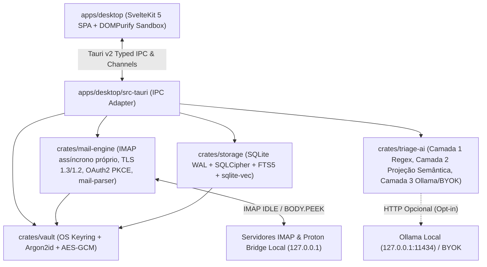

# triage-mail

**Agregador e Centro de Triagem de E-mails 100% Local-First e Agnóstico de Provedor, construído com Rust, Tauri v2, SQLite (SQLCipher + FTS5 + sqlite-vec) e SvelteKit 5.**

**[English](README.md)** | **[Português (Brasil)](README.pt-br.md)**

[](https://github.com/ye-sandbox/triage-mail/actions/workflows/ci.yml)


---

## Overview

O `triage-mail` é um motor de leitura unificada, busca híbrida instantânea e triagem automatizada de e-mails focado no fluxo de entrada (*Inbound*), projetado para usuários que gerenciam múltiplas contas (Gmail, Outlook/Microsoft 365, Yahoo, iCloud, Proton Mail Bridge e domínios próprios via IMAP). Em vez de operar como um cliente de e-mail tradicional pesado, o sistema atua exclusivamente na triagem rápida, extração inteligente e busca local.

Todas as credenciais, corpos de mensagens e índices vetoriais residem exclusivamente na máquina do usuário sob criptografia em repouso, com zero telemetria e sem dependências de runtimes externos pesados:

- **Binário Nativo & Baixo Consumo:** Stack pura em Rust (`tokio`) + Tauri v2 + SvelteKit 5 SPA (binário desktop nativo enxuto, sem Electron e sem sidecars Python/Node).
- **Busca Híbrida de Alta Performance:** Combina busca léxica exata configurável via SQLite `FTS5` (padrão `unicode61 remove_diacritics 2`, `trigram` opcional) e busca semântica vetorial KNN via extensão `sqlite-vec` embutida (quantização `int8` com pré-filtragem; $\le 15$ms semântica filtrada p95, ~52ms híbrida global p50 em 100k mensagens, ADR-008).
- **Caixa Unificada Virtualizada:** Projetada para lidar com `100k+` mensagens com pegada de memória delimitada ($\le 18$ linhas DOM montadas), triagem orientada por atalhos de teclado (*Command Palette*), sincronização incremental (`UIDVALIDITY`/`CONDSTORE`) e sincronização bidirecional de *flags* IMAP.
- **Autenticação Multimodo Transparente:** Suporte a Senhas de App (*App Passwords*), OAuth2 PKCE público, credenciais BYO OAuth fornecidas pelo usuário (`client_id`/`client_secret` salvos no cofre do SO), IMAP padrão (TLS 1.3 e TLS 1.2) e Proton Mail Bridge local através de um conector `ImapConnector` agnóstico.
- **Pipeline de IA Local-First em 3 Camadas:**
  - *Camada 1 (Determinística, Custo Zero):* Regex e heurísticas nativas em Rust para extração imediata de códigos 2FA/OTP, Boletos FEBRABAN (com extração determinística de valor em R\$ e data de vencimento), chaves/payloads Pix, metadados de NF-e, códigos de rastreio, `List-Unsubscribe` + cancelamento em 1 clique RFC 8058 (`List-Unsubscribe-Post`) e categorização automática (`Financeiro`, `Segurança`, `Newsletter`, `Pessoal`).
  - *Camada 2 (Embeddings ONNX em CPU Local):* Inferência neural MiniLM ativada por consentimento, com modelo/runtime verificados e instalados separadamente e indexação `int8[384]` por geração para `sqlite-vec`.
  - *Camada 3 (LLM Generativo Opcional):* Resumos sob demanda via Ollama local (`http://127.0.0.1:11434`) ou provedores Cloud explícitos via BYOK (*Bring Your Own Key*).
- **Painel de Vencimentos e Lembretes Programados:** Boletos FEBRABAN e faturas extraídos alimentam automaticamente um painel de vencimentos com cópia do código de barras em 1 clique, divisão por status (Atrasados, Vencendo Hoje, A Vencer), aviso de não pagamento e lembretes programáveis (dias antes do prazo ou tempo sem leitura) disparados localmente ou via destinos externos (Webhooks, Telegram, Discord).
- **Segurança Zero-Knowledge & Renderização Isolada:** Cofre do sistema operacional (`keyring` + cofre fallback `argon2`), armazenamento completo em SQLCipher AES-256, política de anexos sob demanda (*Lazy Attachments* via `IMAP BODY.PEEK`) e sanitização estrita de HTML (`DOMPurify` em `<iframe sandbox="">` com CSS base normalizado para modo escuro e bloqueio padrão de pixels de rastreamento).

## Architecture

O repositório é estruturado como um Cargo Workspace modular para que as crates principais em Rust (`mail-engine`, `storage`, `vault`, `triage-ai`) permaneçam desacopladas da interface gráfica e possam rodar de forma *headless* (CLI ou container Docker) no futuro:



## Status e Limitações Conhecidas

O `triage-mail` é um motor de entrada e triagem de e-mails em versão MVP (v0.1.0) com os seguintes limites empíricos de desempenho e escopo arquitetural:

- **Limites de Latência de Busca (ADR-008):** Em 100.000 mensagens no hardware de referência (AMD Ryzen 7 7700), as latências observadas em p95 warm são: semântica com filtro de partição $\le 15$ ms (12,9 ms), busca léxica $\le 40$ ms (37,3 ms), semântica exata global $\le 50$ ms (47,8 ms) e busca híbrida concorrente $\le 60$ ms (52,4 ms p50). A varredura vetorial exata global em 100k itens transmite 38,4 MB de embeddings `int8[384]` brutos através da descriptografia AES-256 do SQLCipher; busca vetorial global abaixo de 15ms é fisicamente inviável em CPU sem aproximações. Pré-filtragem de candidatos via quantização escalar de 1 bit (POPCNT Hamming distance) está agendada para avaliação na v0.2.
- **Exibição Nativa e Rolagem Virtual:** A lista de mensagens virtualizada mantém uma pegada de DOM delimitada ($\le 18$ linhas montadas) em 100k mensagens. Intervalos de callback de frame observados no WebKitGTK nativo registraram p95 em ~23ms sob Linux/WSL. Apresentação a 60fps acelerada por hardware depende dos drivers locais de GPU e compositor e não é garantida em todas as distribuições Linux.
- **Busca Semântica na Camada 2:** A inferência MiniLM nativa em CPU substitui projeções no desktop. A busca semântica requer ativação explícita, arquivos de modelo/runtime verificados e índice local compatível completo; a busca por palavras continua disponível durante reconstruções.
- **Cliente IMAP Próprio (ADR-009):** A comunicação IMAP emprega um cliente assíncrono próprio desenvolvido sobre `tokio` e `tokio-rustls` (suportando TLS 1.3 e TLS 1.2, com pinning de certificado em loopback para Proton Mail Bridge), substituindo a biblioteca `async-imap` para garantir `#![forbid(unsafe_code)]` e busca tardia de corpos sem download de anexos via RFC 3501 `BODYSTRUCTURE`.
- **Escopo Exclusivo de Entrada (*Inbound-Only*):** O MVP v0.1 foca estritamente na sincronização, leitura local, busca e triagem de mensagens de entrada. Composição de e-mails e envio via SMTP estão postergados para a v0.2.
- **Escopo de Sincronização Multipasas:** A sincronização indexa pastas padrão (INBOX, Archive, Trash) com busca de partes de texto em duas fases. Anexos binários são baixados sob demanda via `IMAP BODY.PEEK[<part_id>]`.

## Quickstart

### Pré-requisitos

- **Toolchain Rust:** `rustup` (`stable`, edição Rust 2021/2024) + bibliotecas de sistema do Tauri v2 (`libwebkit2gtk-4.1-dev`, `libsecret-1-dev` no Linux).
- **Node.js & Gerenciador de Pacotes:** Node.js `24.19.0` e `pnpm 11.25.0` (mesmas versões do CI).

No Ubuntu 24.04, instale os pré-requisitos nativos de compilação (também usados pelo CI):

```bash
sudo apt-get update
sudo apt-get install --no-install-recommends -y \
  build-essential pkg-config perl libssl-dev libwebkit2gtk-4.1-dev \
  libgtk-3-dev libsecret-1-dev libayatana-appindicator3-dev librsvg2-dev
```

### Instalação e Verificação

```bash
# 1. Copie as variáveis padrão de desenvolvimento
cp .env.example .env

# 2. Instale as dependências do frontend
pnpm install --frozen-lockfile

# 3. Verifique a compilação e os testes unitários do workspace Rust
cargo test --workspace

# 4. Inicie o frontend; em outro terminal execute cargo run --package triage-mail-desktop
pnpm --filter desktop dev --port 1420
```

## Configuration

As credenciais de contas e chaves de criptografia do banco são armazenadas exclusivamente no cofre do sistema operacional (`crates/vault`), nunca em arquivos de texto plano. O arquivo `.env.example` define apenas parâmetros opcionais de desenvolvimento:

| Variable | Description | Default | Required |
| :--- | :--- | :--- | :--- |
| `RUST_LOG` | Diretivas de filtro de logs para as crates Rust | `info,triage_mail=debug,mail_engine=info,storage=info` | No |
| `TRIAGE_DB_PATH` | Caminho alternativo do banco SQLCipher para desenvolvimento | `./.agent/scratch/dev-triage.db` | No |
| `TRIAGE_EMBEDDING_MODEL` | Exemplo de modelo de desenvolvimento reservado; o desktop fixa `all-MiniLM-L6-v2` | `all-MiniLM-L6-v2` | No |
| `OLLAMA_BASE_URL` | Endpoint HTTP do Ollama local para resumos sob demanda (Camada 3) | `http://127.0.0.1:11434` | No |
| `OLLAMA_MODEL` | Modelo padrão do Ollama local | `qwen2.5:3b` | No |
| `PROTON_BRIDGE_HOST` | Endereço de loopback local para o Proton Mail Bridge IMAP | `127.0.0.1` | No |
| `PROTON_BRIDGE_PORT` | Porta de loopback local para o Proton Mail Bridge IMAP | `1143` | No |

## Guia de Conexão de Contas e Autenticação

O `triage-mail` oferece suporte a quatro métodos de autenticação sob um transporte agnóstico de IMAP. Os principais provedores de e-mail bloqueiam o uso da senha normal da conta em conexões IMAP; utilize o método recomendado abaixo para cada serviço.

### Descoberta de provedores

Informe um endereço de e-mail e saia do campo para buscar configurações locais dos
provedores. As predefinições cobrem Gmail, domínios pessoais Microsoft, Yahoo,
iCloud, Fastmail, Zoho (US/UE), GMX, Mail.com, AOL, Yandex, UOL, BOL, Terra e Proton (via Bridge). Domínios próprios e organizacionais podem
exigir configuração manual; uma predefinição não verifica a conta nem garante
acesso IMAP no plano contratado.

**Buscar configurações online** envia explicitamente apenas o domínio ao ISPDB do
Mozilla Thunderbird por HTTPS, com timeout de três segundos e limite de resposta
de 64 KiB. Nunca envia o endereço completo, senha ou credenciais OAuth. Somente
configurações IMAP com TLS implícito são aceitas. Não há teste automático de hosts.
**Confirmar e testar** conecta apenas ao host público exibido na porta 993, verifica
o TLS e a saudação IMAP e não envia credenciais. O sucesso do teste não verifica o login.

**Detectar via DNS** é um botão separado que consulta apenas os registros MX do
domínio digitado (prazo de três segundos, no máximo 10 registros, nunca a parte local).
Ele só seleciona uma predefinição Google Workspace ou Microsoft 365 e nunca roda
automaticamente.

Quando os registros MX pertencem ao Cloudflare Email Routing (serviço que apenas
encaminha, sem host IMAP), o formulário mostra um roteiro de roteamento em vez de uma
predefinição: conecte a caixa de destino (Hub) e liste os endereços encaminhados em
**Aliases / domínios roteados** no cartão da conta. Cada alias vira uma caixa virtual
na barra lateral que filtra a conta Hub para as mensagens entregues àquele endereço.
Aliases são rótulos locais guardados no banco criptografado; não geram login nem
requisição de rede extra.

Use **Configurações avançadas de conexão** para host/porta manuais, BYO OAuth ou
Proton Bridge. Edições manuais e seleção de predefinições impedem que a busca automática
sobrescreva o formulário. O Gmail tem um link direto para Senhas de aplicativo.
**Configurar login Microsoft** preenche as configurações PKCE da Microsoft; informe
o ID de cliente do seu próprio aplicativo desktop registrado e selecione **Autorizar
e conectar**. Nenhum ID de aplicativo ou segredo é distribuído com o programa.

### Visão Geral dos Métodos de Autenticação

| Método | Indicado Para | Pré-requisitos | Serviços Compatíveis |
| :--- | :--- | :--- | :--- |
| **App Password** (Senha de App) | Configuração rápida e direta sem contas de desenvolvedor | Verificação em duas etapas (2FA) ativada na conta; IMAP ativado no webmail | Gmail, Google Workspace, iCloud, Yahoo, AOL, Fastmail, Outlook, IMAP próprio |
| **OAuth · Public PKCE** | Login seguro via navegador sem armazenar segredos de cliente | Provedor compatível com RFC 7636 PKCE e redirecionamento de loopback `127.0.0.1` | Microsoft 365, Outlook.com, Hotmail, provedores OIDC padrão |
| **OAuth · BYO Credentials** | Fluxo contínuo de tokens OAuth para Google ou servidores corporativos | Projeto de desenvolvedor com `client_id` e `client_secret` (aplicativo Desktop) | Google / Gmail (via Console GCP), SSO corporativo privado (Keycloak, Okta) |
| **Proton Mail Bridge** | Contas Proton Mail com criptografia de ponta a ponta | Plano pago do Proton + aplicativo oficial Proton Mail Bridge aberto localmente | Exclusivo para Proton Mail |

O formulário de nova conta exibe um cartão de recomendação compacto para o provedor detectado (Gmail → Senha de Aplicativo, Outlook → login Microsoft, Proton → Bridge, domínios desconhecidos → IMAP manual) e recolhe os demais métodos em "Mais métodos de acesso".

### Detalhes de Configuração por Provedor

#### Google / Gmail
- **Recomendado (Senha de Aplicativo):**
  1. Ative a verificação em duas etapas no painel de [Segurança da Conta Google](https://myaccount.google.com/security).
  2. Acesse [Senhas de app](https://myaccount.google.com/apppasswords) e crie uma senha de 16 caracteres (ex.: com o nome `Triage Mail`).
  3. Verifique se o IMAP está ativado no Gmail (*Configurações $\rightarrow$ Ver todas as configurações $\rightarrow$ Encaminhamento e POP/IMAP $\rightarrow$ Ativar IMAP*).
  4. No `triage-mail`, selecione **App password**: Host `imap.gmail.com`, Porta `993` e cole a senha de 16 caracteres gerada. Os espaços da senha como o Google a exibe são removidos automaticamente, e uma dica aparece se o valor não parecer uma senha de app.
- **Alternativa (BYO OAuth):**
  1. Crie um projeto no [Google Cloud Console](https://console.cloud.google.com/).
  2. Configure a Tela de consentimento OAuth (Externa, com o escopo `https://mail.google.com/`).
  3. Crie Credenciais $\rightarrow$ ID do cliente OAuth $\rightarrow$ Tipo de aplicativo **App para computador** (Desktop app).
  4. No `triage-mail`, selecione **OAuth · Your client credentials**:
     - Endpoint de autorização: `https://accounts.google.com/o/oauth2/v2/auth`
     - Endpoint de token: `https://oauth2.googleapis.com/token`
     - Escopos: `https://mail.google.com/`
     - Client ID e Client Secret gerados no GCP.
  5. Enquanto a tela de consentimento estiver em modo *Teste*, o Google expira os refresh tokens após 7 dias. Publique-a **Em produção** (gratuito para uso pessoal) para evitar reautorizações semanais.

#### Microsoft (Outlook.com / Hotmail / Microsoft 365)
- **Recomendado (OAuth · Public PKCE):**
  1. No `triage-mail`, selecione **OAuth · Public PKCE**.
  2. Host: `outlook.office365.com`, Porta: `993`.
  3. Endpoint de autorização: `https://login.microsoftonline.com/common/oauth2/v2.0/authorize`
  4. Endpoint de token: `https://login.microsoftonline.com/common/oauth2/v2.0/token`
  5. Escopos: `offline_access https://outlook.office.com/IMAP.AccessAsUser.All`
  6. Client ID: ID de aplicativo público da Microsoft registrado para PKCE desktop.
- **Alternativa (Senha de Aplicativo):**
  1. Se a verificação em duas etapas estiver ativada na sua conta Microsoft, gere uma senha de aplicativo em *Opções de segurança avançadas*.
  2. No `triage-mail`, selecione **App password**: Host `outlook.office365.com`, Porta `993`.

#### Apple iCloud Mail
1. Ative a autenticação de dois fatores no seu ID Apple.
2. Acesse [appleid.apple.com](https://appleid.apple.com) e navegue até *Início de sessão e segurança $\rightarrow$ Senhas específicas de apps*.
3. Gere uma nova senha para o `triage-mail`.
4. No `triage-mail`, selecione **App password**:
   - Host: `imap.mail.me.com`
   - Porta: `993`
   - E-mail: seu endereço de e-mail iCloud
   - Senha: a senha específica gerada pela Apple.

#### Yahoo Mail & AOL
1. Acesse *Informações da conta $\rightarrow$ Segurança da conta*.
2. Role até *Gerar senha de aplicativo* e selecione *Outro aplicativo* $\rightarrow$ digite `triage-mail`.
3. No `triage-mail`, selecione **App password**:
   - Host: `imap.mail.yahoo.com` (ou `imap.aol.com` para AOL)
   - Porta: `993`
   - Senha: a senha de aplicativo de 16 caracteres.

#### Proton Mail (via Proton Mail Bridge)
1. Confirme se você possui uma assinatura paga ativa do Proton (obrigatória pela Proton para liberar o Bridge).
2. Baixe, instale e abra o aplicativo oficial **Proton Mail Bridge** na sua máquina.
3. Adicione sua conta Proton dentro do Bridge e aguarde a sincronização local.
4. Nas configurações do Bridge, confirme que o IMAP está em modo SSL/TLS (porta padrão `1143`).
5. Abra os detalhes da conta no Proton Mail Bridge para visualizar o **Username** e o **Password** do Bridge.
6. No `triage-mail`, selecione **Proton Mail Bridge**:
   - Host: `127.0.0.1` (estritamente loopback local)
   - Porta: `1143`
   - Username: Nome de usuário exibido no Bridge
   - Senha do Bridge: A senha gerada pelo aplicativo Bridge (*nunca* a senha principal da sua conta Proton).

#### Servidores IMAP Próprios / Corporativos (Dovecot, Postfix, Zimbra, cPanel)
1. No `triage-mail`, selecione **App password**.
2. Preencha seu endereço de e-mail completo, o endereço do servidor IMAP (ex.: `mail.example.org`) e a porta TLS (`993`).
3. Insira sua senha normal ou token de aplicativo gerado no painel do servidor.

## Usage

```bash
# Executar testes das crates core (parser MIME, triagem determinística 2FA/Boleto, storage)
cargo test --workspace

# Compilar a SPA e depois o binário desktop nativo (sem empacotar instalador)
pnpm --filter desktop build
cargo build --release --package triage-mail-desktop
```

### CLI offline para mensagens em cache

Compile o executável sem GUI e consulte um cache criptografado existente:

```bash
cargo build --release --locked -p triage-mail-cli
target/release/triage-mail-cli --data-dir /path/to/triage-mail accounts
target/release/triage-mail-cli --data-dir /path/to/triage-mail search --query boleto --limit 20
target/release/triage-mail-cli --data-dir /path/to/triage-mail show --message-id msg-a
cargo test --locked -p triage-mail-cli
```

As chaves permanecem no cofre existente. Para desbloquear o cofre alternativo, adicione
`--unlock-stdin` e forneça a frase-senha por um gerenciador de senhas confiável ou descritor
de arquivo privado; stdin de terminal é recusado. Instalações restauradas exigem esse
desbloqueio. Stdout contém mensagens privadas em JSON limitado. A CLI aceita apenas o
esquema 11 e realiza consultas locais somente de leitura, sem inicialização, migração,
sincronização ou automação. O acesso ao WAL do SQLite pode exigir arquivos de memória
compartilhada/permissões no diretório. Consulte a [referência da CLI](docs/cli.md)
para formatos, limites, códigos de saída e compatibilidade.

### Container da CLI offline

No Linux x86_64, empacote a CLI usando apenas dependências de compilação em cache e
bibliotecas do host; nenhuma imagem-base ou dependência é baixada:

```bash
scripts/build-cli-image.sh triage-mail-cli:local
TRIAGE_CLI_TEST_IMAGE=triage-mail-cli:local cargo test --offline --locked -p triage-mail-cli --test offline container_reads_readonly_encrypted_wal_and_fails_closed -- --ignored --exact
```

A imagem `scratch` sem root oferece os mesmos comandos offline. Use um volume de
dados existentes somente de leitura, frase-senha do cofre alternativo via stdin,
`--network=none`, logs do Docker desativados e as demais restrições das
[instruções do container](docs/cli.md#linux-container-packaging).
Arquivos WAL/SHM existentes e utilizáveis são necessários; a ausência causa recusa.
Sincronização ativa, daemon e automação continuam como trabalho futuro separado.

### Conversas e triagem em grupo

Selecione **Conversas** acima da lista para agrupar mensagens em cache dentro de cada conta.
A visualização padrão por mensagem continua disponível. O agrupamento usa apenas Message-ID,
In-Reply-To e References; assuntos iguais não unem mensagens. Cabeçalhos ausentes ou inválidos
podem deixar mensagens isoladas, e IDs duplicados ambíguos não resolvem vínculos. O agrupamento
não verifica autores. Um contador mostra a preparação do índice do histórico local.

As linhas mostram contagens de correspondentes, mensagens em cache e não lidas. Abra uma
conversa para percorrer páginas cronológicas, incluindo mensagens identificadas como fora da
visualização ou pasta atual. Abra uma mensagem para carregar seu corpo pelo leitor existente,
sanitizado e isolado. Anexos continuam sendo baixados apenas mediante solicitação explícita.

As ações de leitura, não leitura, arquivamento e etiqueta afetam, por padrão, as mensagens
correspondentes em cache. Selecione **Incluir todas as mensagens em cache** separadamente para
incluir outras pastas ou mensagens fora do filtro. Revise conta, pastas e mensagens afetadas
antes de confirmar. Confirmações expiram em cinco minutos; alterações de grupo ou filtros exigem
atualização. Novas mensagens ficam de fora. Seleções acima de 500 mensagens devem ser reduzidas.
As alterações locais são atômicas; as remotas podem concluir ou falhar separadamente.
Pendências, falhas e contagens de tentativas aparecem junto às mensagens enquanto o aplicativo
ativo repete as operações. Não há leitura automática nem cancelamento de inscrição em grupo.

A consolidação do índice e a busca agrupada percorrem metadados da conta ou dos resultados;
latência em caixas grandes e bloqueios do banco continuam sendo limitações. A busca híbrida
por conversa usa rankings completos dos ramos elegíveis; o modo por mensagem não muda. Execute
`cargo run --offline --release -p storage --example conversation_performance` para a massa
sintética criptografada. As medições não comprovam comportamento nativo a 60fps.

### Revisão local de novos remetentes

Ative **Configurações → Novos remetentes** separadamente para cada conta. A revisão vem
desativada. O histórico em cache e da primeira sincronização registra remetentes como
**Conhecidos**; isso não significa aceitação. A inicialização usa lotes locais. A primeira
sincronização de uma pasta, reconstruções de UIDVALIDITY e UIDNEXT desconhecido adotam
uma política conservadora: mensagens recebidas nessas janelas podem ser conhecidas em
vez de pendentes. Escolhas anteriores são preservadas.

Selecione **Novos remetentes → Revisão pendente** ou **Recusados** para inspecionar as
mensagens no leitor e nos modos de busca habituais. A seleção de conta atual vale para
todas as suas pastas. Aceite, recuse ou volte a pendente após confirmar o endereço exato
e a conta. A escolha vale para mensagens em cache existentes e futuras e sobrevive à
ressincronização e remoção do cache até excluir a conta. As configurações listam até
200 remetentes por página. Identidades ausentes ou ambíguas permanecem visíveis e não
permitem escolhas por remetente. A comparação usa o parser compartilhado de uma única
caixa postal, endereços em minúsculas ASCII e nenhuma unificação de aliases do provedor.
Familiaridade não autentica o autor.

A ativação padrão permite apenas revisão. A opção separada **Ocultar pendentes e
recusados apenas na Caixa de entrada** altera os resultados locais dessa caixa; Todas
as mensagens, outras pastas, categorias, buscas salvas e revisão mantêm o acesso.
Recusar nunca exclui mensagens nem bloqueia a entrega no provedor. Regras, lembretes e
alertas continuam independentes. Desativar restaura a visibilidade imediatamente;
reativar registra o histórico intermediário e mantém escolhas e revisões pendentes.
Não requer modelo, download de anexo nem requisição de rede. Evidências e limites de
desempenho estão em [`docs/performance/sender-review.md`](docs/performance/sender-review.md).

```bash
cargo run --offline --release -p storage --example sender_review_performance
```

### Categorias automáticas locais

Use **Categorias locais** na barra lateral para filtrar a caixa atual em todo o conjunto
de resultados nativos. As seis categorias locais são Pessoas, Finanças, Compras, Boletins,
Notificações e Segurança. A prioridade determinística é Segurança, Finanças, Compras,
Boletins, Notificações e, por padrão, Pessoas. Pessoas não comprova um remetente humano;
endereços de remetentes não são autenticados. Nenhum modelo é baixado ou serviço de nuvem consultado.

Expanda **Categorias locais** na mensagem selecionada para consultar a classificação
automática, o motivo e a origem efetiva. Corrija apenas essa mensagem ou confirme,
separadamente, uma preferência para o endereço exato nas mensagens existentes e futuras
daquela conta no cache. Correções individuais têm prioridade sobre preferências do
remetente, que têm prioridade sobre a classificação automática. Redefina cada camada
para usar a próxima. **Configurações → Categorias locais** lista as preferências ativas
para remoção. Alterações preservam os indicadores de extração e nunca movem mensagens
nem executam regras, lembretes ou entregas. Salvar a busca atual mantém o filtro de categoria.

Os metadados ficam no SQLCipher. O histórico é classificado em lotes retomáveis enquanto
o aplicativo está ativo e desbloqueado; as visualizações convergem durante esse processo.
Correções resistem à sincronização comum, reinicialização e movimentações canônicas.
Após excluir o cache, a restauração requer o mesmo ID do provedor vinculado à conta ou
um Message-ID válido com a data de recebimento. Sem eles, a correção dura apenas enquanto
o registro estiver no cache; os controles da mensagem informam esse limite. Remover a
conta exclui seus metadados. Os controles não treinam modelos. Medições offline e limites:
[`docs/performance/categories.md`](docs/performance/categories.md).

### Buscas salvas e pastas virtuais

Use **Buscas salvas** na barra lateral para criar uma visualização nomeada, salvar a busca
atual e seu escopo de caixa ou editar um modelo de clientes não lidos, notas fiscais ou
próximos boletos. As visualizações aceitam todas as contas ou um conjunto selecionado,
texto/modo de busca, estados de leitura/estrela/anexos, etiquetas obrigatórias, remetente
e domínio exatos, tipo de extração e vencimentos de boletos. Todos os filtros devem
corresponder. Seleção vazia significa todas as contas; uma seleção explícita nunca se
amplia silenciosamente após excluir uma conta. Edite referências inválidas para corrigir
uma visualização indisponível. Remova o escopo de caixa no editor para abranger contas.

As definições ficam no SQLCipher. A busca nativa filtra antes de ordenar e paginar;
selecionar uma visualização não move mensagens nem executa regras. Sincronização,
triagem, foco/retomada e meia-noite UTC atualizam os resultados ativos. Próximos boletos
inclui hoje até os próximos 30 dias UTC; datas ausentes não correspondem e a extração
não indica pagamento. Escolha remetente ou etiqueta no modelo de clientes não lidos;
clientes não são inferidos. Correspondência de remetente não autentica identidade.
Modos semânticos mantêm o consentimento experimental e o requisito de modelo local.
Edite para renomear ou mudar filtros; excluir a visualização ativa retorna a Todas as
mensagens. Nenhum lembrete ou envio agendado é adicionado. Resultados sintéticos de
desempenho e limitações estão em
[`docs/performance/saved-views.md`](docs/performance/saved-views.md).

### Regras locais e filtros automáticos

Abra **Configurações → Regras** para criar, editar, desativar ou reordenar filtros locais.
A ação **Criar regra da mensagem** preenche conta e remetente em um rascunho não salvo.
Escolha condições de todas/qualquer/exceto e ações de etiqueta, estrela ou arquivamento;
ative a regra antes de salvar. O texto ignora maiúsculas; domínios são exatos, salvo quando
subdomínios são selecionados. Valores usam centavos inteiros de BRL e datas `YYYY-MM-DD`.

As regras seguem a ordem exibida e processam novas mensagens após a referência inicial
de histórico de cada pasta. Uma regra correspondente com parada ignora as seguintes;
ações repetidas são unificadas. Importações iniciais e reconstruções por UIDVALIDITY não
acionam regras. Salvar ou ativar uma regra nunca altera mensagens antigas. Selecione uma
mensagem na caixa de entrada e use **Simular mensagens selecionadas** para conferir
correspondências e ações sem alterar mensagens. Dados ausentes no cache não satisfazem
condições positivas, anexos binários nunca são baixados e uma correspondência de remetente
não autentica identidade. O processamento exige o aplicativo em execução. Após configurar
os destinos de alerta, eles também podem ser selecionados como ações das regras.

### Notificações locais, Telegram, Discord e alertas por webhook

Abra **Configurações → Alertas** para adicionar um destino. Destinos começam desativados.
Notificações locais são genéricas e podem aparecer na tela bloqueada; esta versão usa o serviço
de notificações do desktop Linux e informa indisponibilidade/negação explicitamente. Outros
sistemas operacionais atualmente retornam indisponível. Webhooks aceitam hosts DNS públicos
HTTPS na porta 443, incluindo fluxos n8n públicos próprios; rede privada, loopback, IP literal
e HTTP não são suportados. URLs completas e credenciais bearer opcionais ficam apenas no vault;
as listas exibem origens públicas.

Para **Telegram**, crie um bot com o BotFather, inicie-o no chat desejado (ou adicione-o a um
grupo/canal com permissão para publicar) e informe o token e o ID numérico exato do chat obtido
nas suas ferramentas de administração do Telegram. Não há descoberta de chats; nomes de usuário
e migração automática de chat não são suportados. Confirme o destinatário antes de ativar. Token
e ID do chat ficam no vault; as listas mostram somente `https://api.telegram.org`.

Para **Discord**, crie um webhook nas configurações **Integrações → Webhooks** do canal desejado
e cole sua URL canônica `https://discord.com/api/webhooks/…`. Confirme o canal no Discord;
queries, hosts alternativos, seleção de threads e anexos não são suportados. A URL secreta completa
fica no vault; as listas mostram somente `https://discord.com`.

Ambos enviam uma mensagem de texto contendo os campos JSON selecionados, com truncamento visível
nos limites conservadores de 3.500 unidades UTF-16 para Telegram e 1.800 para Discord. Telegram usa
texto simples sem prévias de links; Discord suprime menções e incorporações. Não há promessa de
idempotência. Respostas limitadas fornecem apenas aceitação/códigos de erro e espera para nova
tentativa; seus corpos nunca são registrados, armazenados ou retornados. Resultados de nova
tentativa persistem uma pausa conservadora em todos os destinos daquele provedor, inclusive os
que compartilham credenciais. Configurar/salvar não contata provedores. Testes offline cobrem o
protocolo; interoperabilidade com destinatários reais não foi verificada.

Selecione os campos exportados e confirme o destino exibido antes de ativá-lo; depois, selecione-o
em uma regra. Por padrão, o payload contém somente versão do esquema, ID opaco do evento, data/hora
e indicação de truncamento. Remetente, assunto, ID da conta, trecho, valores/vencimentos de boletos,
metadados de anexos e corpo em texto simples exigem seleção individual. Corpo/trecho podem expor
dados de verificação ou pagamento. O corpo limita-se a 6.000 bytes UTF-8, trechos a 512 bytes,
coleções a 16 itens e JSON a 64 KiB, com truncamento explícito. HTML, cabeçalhos brutos, anexos
binários e valores brutos de OTP/Pix extraídos são excluídos. Conteúdo ausente nunca é buscado.

Em **Resumos e horário de silêncio**, escolha entrega imediata, a cada hora (minuto da
hora) ou diária (horário) por destino, no horário local do sistema ou UTC. Intervalos
incluem o início e excluem o fim, podendo atravessar a meia-noite. Horários inexistentes
no horário de verão avançam ao primeiro minuto válido; horários repetidos executam uma
vez, na primeira ocorrência. A prévia mostra o próximo horário elegível sem enviar.

Janelas perdidas são reunidas em um resumo; itens não enviados expiram após 24 horas.
Resumos mantêm até 50 entradas detalhadas em 64 KiB, com contagens de total/omissões;
limites de texto dos provedores podem truncar mais. A fila criptografada comporta até
1.000 itens por destino e informa excedentes. Um resumo pendente mantém ID, payload e
prazo de tentativa do item mais antigo. Remover um participante cancela o resumo inteiro
não enviado, incluindo os demais itens. Ler uma mensagem com lembrete de não lida ou
cancelar sua configuração de lembrete também cancela entregas pendentes afetadas.

Ações de regra **Alerta urgente** ignoram resumos/silêncio somente com permissão separada
na programação do destino. Sem ela seguem a programação normal; lembretes são sempre
normais. Limites de taxa e consentimento de campos continuam valendo. Alterar a política
cancela envios automáticos anteriores. Recuos de relógio/fuso expiram conservadoramente
janelas civis já encerradas em vez de repeti-las. A confirmação de teste/reenvio informa
que ignora a programação, sem liberar itens normais pendentes.

**Testar entrega** envia um evento sintético somente após confirmação. **Reenviar mensagens
selecionadas** exige seleção explícita de mensagens/destino e confirmação; envia os campos
selecionados atuais sem aplicar ações nas mensagens. Simulação nunca envia. O histórico inicial
nunca gera alertas. Edição/desativação cancela revisões pendentes; ativação nunca reenvia trabalho
cancelado. Excluir mensagem/conta cancela seus alertas pendentes, inclusive exclusão de cache após
algumas movimentações.

Mantenha o aplicativo ativo e desbloqueado para processamento; um executor headless de automação é
trabalho futuro. Tentativas usam IDs estáveis/Idempotency-Key, espera e taxa limitadas (seis
inícios/minuto por destino), com no máximo oito tentativas/24 horas. Timeouts/falhas podem gerar
duplicatas; destinatários devem deduplicar pelo ID do evento. Aceito indica aceitação pelo
serviço/destinatário, não visualização humana. Desativar aguarda uma requisição iniciada (até dez
segundos), que não pode ser recolhida. O histórico contém estados/contagens/horários seguros por
até 30 dias e 1.000 registros por destino. Payloads concluídos são apagados. Nenhum teste real é
enviado automaticamente.
Desative ou exclua um destino para parar os envios locais. Revogue o token no BotFather ou exclua
o webhook no Discord para revogar o acesso no provedor; este aplicativo não revoga credenciais
compartilhadas remotamente. Nenhuma dessas operações recolhe mensagens já aceitas.

### Backup criptografado e regras portáteis

Em **Configurações → Backup**, crie um backup local protegido por senha ou
exporte/importe regras e buscas salvas como JSON legível. A prévia de importação
exige mapeamento explícito de contas e destinos; regras entram desativadas com novas
identidades. Nomes, consultas e condições no JSON podem conter texto privado.

A restauração aparece antes da configuração inicial, quando o diretório de dados
do aplicativo ainda não existe. Cria um cofre local isolado, nunca substitui bancos
ou cofres existentes e exige novamente a senha do backup para desbloquear.
Reconecte contas em cache adicionando o mesmo endereço exato em Contas. Regras,
lembretes e destinos ficam desativados; consentimentos de IA/rede e envios pendentes
não são restaurados. Binários de anexos não baixados, arquivos externos de anexos,
modelos, credenciais e URLs secretas de integrações estão ausentes. A seleção nativa
de arquivos exige um portal de desktop Linux. Veja [conteúdo, limites e recuperação
do backup](docs/backup.md) (em inglês).

## Busca Semântica Local

Instale o modelo/tokenizer MiniLM e o runtime CPU ONNX fixados seguindo o
[guia de configuração e hashes](docs/onnx.md), depois ative a busca em Configurações → Busca.
O aplicativo não faz downloads automáticos. O formulário exige URLs HTTPS diretas
com os arquivos fixados e consentimento explícito; instale o runtime nativo separadamente.
Progresso local e reconstrução confirmada estão disponíveis em inglês e português.
Índices parciais/incompatíveis são bloqueados; nenhuma mensagem é enviada para inferência.

Testes opcionais offline do modelo/grafo e a medição de indexação em banco criptografado
descartável estão em [docs/onnx.md](docs/onnx.md#offline-reproduction). Eles exigem
artefatos provisionados explicitamente; os testes comuns do workspace não exigem.

## Development

### Estrutura do Repositório

```text
.
├── .agent/                   # Governança ADD, contratos ativos (NOTES.md) e roadmap (TASK.md)
├── apps/
│   ├── cli/                  # CLI Rust offline para acesso somente de leitura ao cache
│   └── desktop/              # Frontend SvelteKit 5 SPA + entrypoint Tauri v2 (src-tauri)
├── crates/
│   ├── mail-engine/          # Conector IMAP assíncrono, OAuth2 PKCE, IDLE Manager e MIME Parser
│   ├── storage/              # SQLite WAL + SQLCipher, migrations, FTS5 e sqlite-vec
│   ├── triage-ai/            # Camada 1 Regex (2FA/Boletos/Rastreio), Camada 2 Projeção Semântica e Camada 3 LLM
│   └── vault/                # Integração com OS Keyring e criptografia Argon2id + AES-GCM
├── docs/
│   └── adr/                  # Registros de Decisões Arquiteturais (decisions.md)
├── AGENTS.md                 # Diretrizes de engenharia, invariantes e Definition of Done
├── Cargo.toml                # Manifesto do Cargo Workspace em Rust
└── package.json              # Manifesto do workspace frontend
```

### Comandos de Validação

O [workflow de CI](.github/workflows/ci.yml) executa em pull requests, pushes para `main`
e acionamento manual, com Ubuntu 24.04, Rust 1.99.0 com rustfmt/Clippy, Node.js 24.19.0
e pnpm 11.25.0. As actions usam hashes de commit; as credenciais do checkout não persistem.
A instalação de dependências requer registros de pacotes/toolchains e repositórios Ubuntu.
A validação Rust roda offline após `cargo fetch --locked`; os testes usam dados sintéticos
e servidores locais em loopback, sem credenciais de provedores nem downloads de modelos.
O CI não publica artefatos.

O verificador de políticas, sem dependências, lê arquivos de texto rastreados na árvore de
trabalho, permite domínios reservados de exemplo/teste, rejeita outros endereços de e-mail e
formatos específicos de segredos, e verifica sintaxe legada nos componentes/módulos Runes
Svelte. Exibe apenas locais e nomes das regras, sem os valores encontrados. É uma proteção
limitada, não uma auditoria completa de segredos ou do histórico Git; revise mudanças de
credenciais manualmente. Adicione arquivos novos ao staging antes da verificação local.

```bash
# Verificações do Workspace Rust
cargo check --workspace
cargo test --workspace
cargo fmt --all -- --check
cargo clippy --workspace --all-targets -- -D warnings

# Verificações do Frontend (apps/desktop)
pnpm --filter desktop check
pnpm --filter desktop test
pnpm --filter desktop build

node --test scripts/ci-guard.test.mjs
node scripts/ci-guard.mjs
git diff --check
```

O fuzzing opcional e offline do parser IMAP fica em um workspace Cargo separado.
Após provisionar explicitamente cargo-fuzz, Rust nightly e as dependências fixadas,
execute `CARGO_NET_OFFLINE=true cargo test --locked --manifest-path fuzz/Cargo.toml`
para reproduzir as sementes sintéticas. Consulte [campanhas limitadas e reprodução](docs/testing/imap-fuzzing.md)
para comandos guiados por cobertura, limites de recursos e evidências. Builds normais
não incluem essas ferramentas; nenhum provedor ou dado de email privado é utilizado.

A validação opcional de desempenho usa dados sintéticos para busca SQLCipher com 100.000
mensagens e uma instância separada da interface nativa WebKitGTK, medindo intervalos entre
frames e memória da árvore de processos. Consulte
[metodologia, comandos e limites medidos](docs/performance/native-validation.md).
Essas ferramentas não acessam provedores nem baixam modelos; recompile a SPA normal após a
compilação da interface de teste antes de gerar o binário do aplicativo.
A validação de correção e latência específica das caixas de correio usa
`cargo run --offline --release -p storage --example mailbox_performance`.
Consulte o [relatório de validação das caixas de correio](docs/performance/mailbox-validation.md)
para os cenários por escopo, tempos de IPC nativo, capturas e critérios ainda pendentes.

A investigação de candidatos binários usa a mesma base criptografada de caixas de correio:
`cargo run --offline --release -p storage --example binary_quantization`.
Execute os testes adversariais com `cargo test --offline -p storage --example binary_quantization`.
Consulte a [avaliação de quantização binária](docs/performance/binary-quantization.md) para
os limites de candidatos, equivalência com o oráculo e a decisão de adoção.

## License

Licenciado sob a **GNU Affero General Public License v3.0 (AGPLv3)** — consulte [`LICENSE`](LICENSE) para mais detalhes.
