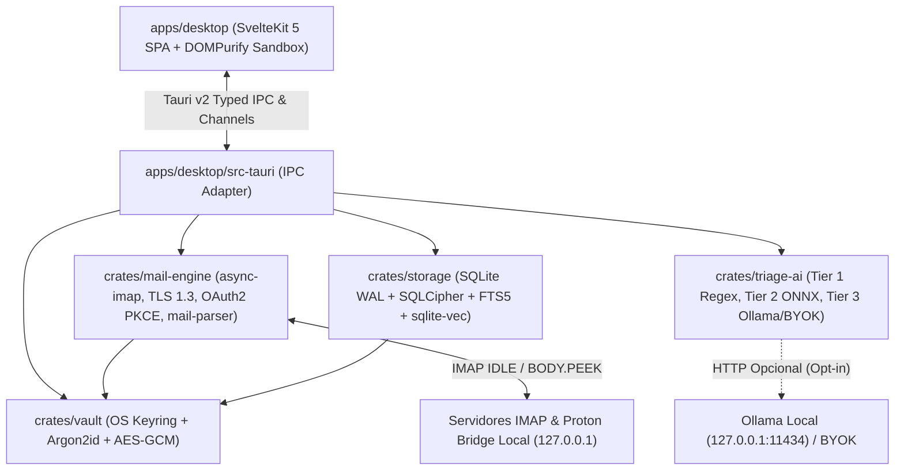

# triage-mail

**Agregador e Centro de Triagem de E-mails 100% Local-First e Agnóstico de Provedor, construído com Rust, Tauri v2, SQLite (SQLCipher + FTS5 + sqlite-vec) e SvelteKit 5.**

**[English](README.md)** | **[Português (Brasil)](README.pt-br.md)**


---

## Overview

O `triage-mail` é um motor de leitura unificada, busca híbrida instantânea e triagem automatizada de e-mails focado no fluxo de entrada (*Inbound*), projetado para usuários que gerenciam múltiplas contas (Gmail, Outlook/Microsoft 365, Yahoo, iCloud, Proton Mail Bridge e domínios próprios via IMAP). Em vez de operar como um cliente de e-mail tradicional pesado, o sistema atua exclusivamente na triagem rápida, extração inteligente e busca local.

Todas as credenciais, corpos de mensagens e índices vetoriais residem exclusivamente na máquina do usuário sob criptografia em repouso, com zero telemetria e sem dependências de runtimes externos pesados:

- **Binário Nativo & Baixo Consumo:** Stack pura em Rust (`tokio`) + Tauri v2 + SvelteKit 5 SPA (binário desktop nativo enxuto, sem Electron e sem sidecars Python/Node).
- **Busca Híbrida em `< 15ms`:** Combina busca léxica exata configurável via SQLite `FTS5` (padrão `unicode61 remove_diacritics 2`, `trigram` opcional) e busca semântica vetorial KNN via extensão `sqlite-vec` embutida (quantização `int8` com pré-filtragem).
- **Caixa Unificada Virtualizada a 60fps:** Projetada para lidar com `100k+` mensagens simultâneas com triagem orientada por atalhos de teclado (*Command Palette*), sincronização incremental (`UIDVALIDITY`/`CONDSTORE`) e sincronização bidirecional de *flags* IMAP.
- **Autenticação Multimodo Transparente:** Suporte a Senhas de App (*App Passwords*), OAuth2 PKCE público, credenciais BYO OAuth fornecidas pelo usuário (`client_id`/`client_secret` salvos no cofre do SO), IMAP TLS 1.3 padrão e Proton Mail Bridge local através de um conector `ImapConnector` agnóstico.
- **Pipeline de IA Local-First em 3 Camadas:**
  - *Camada 1 (Determinística, Custo Zero):* Regex e heurísticas nativas em Rust para extração imediata de códigos 2FA/OTP, Boletos FEBRABAN (com extração determinística de valor em R\$ e data de vencimento), chaves/payloads Pix, metadados de NF-e, códigos de rastreio, `List-Unsubscribe` + cancelamento em 1 clique RFC 8058 (`List-Unsubscribe-Post`) e categorização automática (`Financeiro`, `Segurança`, `Newsletter`, `Pessoal`).
  - *Camada 2 (Embeddings Locais em CPU):* Indexação semântica em background utilizando modelos ONNX quantizados (`all-MiniLM-L6-v2` / `bge-small`) via `fastembed-rs` / `ort` baixados sob demanda no diretório de dados do usuário.
  - *Camada 3 (LLM Generativo Opcional):* Resumos sob demanda via Ollama local (`http://127.0.0.1:11434`) ou provedores Cloud explícitos via BYOK (*Bring Your Own Key*).
- **Segurança Zero-Knowledge & Renderização Isolada:** Cofre do sistema operacional (`keyring` + cofre fallback `argon2`), armazenamento completo em SQLCipher AES-256, política de anexos sob demanda (*Lazy Attachments* via `IMAP BODY.PEEK`) e sanitização estrita de HTML (`DOMPurify` em `<iframe sandbox="">` com CSS base normalizado para modo escuro e bloqueio padrão de pixels de rastreamento).

## Architecture

O repositório é estruturado como um Cargo Workspace modular para que as crates principais em Rust (`mail-engine`, `storage`, `vault`, `triage-ai`) permaneçam desacopladas da interface gráfica e possam rodar de forma *headless* (CLI ou container Docker) no futuro:



## Quickstart

### Pré-requisitos

- **Toolchain Rust:** `rustup` (`stable`, edição Rust 2021/2024) + bibliotecas de sistema do Tauri v2 (`libwebkit2gtk-4.1-dev`, `libsecret-1-dev` no Linux).
- **Node.js & Gerenciador de Pacotes:** Node.js `>= 20` e `pnpm >= 9`.

### Instalação e Verificação

```bash
# 1. Copie as variáveis padrão de desenvolvimento
cp .env.example .env

# 2. Instale as dependências do frontend
pnpm install

# 3. Verifique a compilação e os testes unitários do workspace Rust
cargo test --workspace

# 4. Inicie a aplicação desktop Tauri v2 em modo de desenvolvimento
pnpm --filter desktop tauri dev
```

## Configuration

As credenciais de contas e chaves de criptografia do banco são armazenadas exclusivamente no cofre do sistema operacional (`crates/vault`), nunca em arquivos de texto plano. O arquivo `.env.example` define apenas parâmetros opcionais de desenvolvimento:

| Variable | Description | Default | Required |
| :--- | :--- | :--- | :--- |
| `RUST_LOG` | Diretivas de filtro de logs para as crates Rust | `info,triage_mail=debug,mail_engine=info,storage=info` | No |
| `TRIAGE_DB_PATH` | Caminho alternativo do banco SQLCipher para desenvolvimento | `./.agent/scratch/dev-triage.db` | No |
| `TRIAGE_EMBEDDING_MODEL` | Modelo ONNX local utilizado na Camada 2 de embeddings | `all-MiniLM-L6-v2` | No |
| `OLLAMA_BASE_URL` | Endpoint HTTP do Ollama local para resumos sob demanda (Camada 3) | `http://127.0.0.1:11434` | No |
| `OLLAMA_MODEL` | Modelo padrão do Ollama local | `qwen2.5:3b` | No |
| `PROTON_BRIDGE_HOST` | Endereço de loopback local para o Proton Mail Bridge IMAP | `127.0.0.1` | No |
| `PROTON_BRIDGE_PORT` | Porta de loopback local para o Proton Mail Bridge IMAP | `1143` | No |

## Usage

```bash
# Executar testes das crates core (parser MIME, triagem determinística 2FA/Boleto, storage)
cargo test --workspace

# Compilar binário nativo de produção
pnpm --filter desktop tauri build
```

## Development

### Estrutura do Repositório

```text
.
├── .agent/                   # Governança ADD, contratos ativos (NOTES.md) e roadmap (TASK.md)
├── apps/
│   └── desktop/              # Frontend SvelteKit 5 SPA + entrypoint Tauri v2 (src-tauri)
├── crates/
│   ├── mail-engine/          # Conector IMAP assíncrono, OAuth2 PKCE, IDLE Manager e MIME Parser
│   ├── storage/              # SQLite WAL + SQLCipher, migrations, FTS5 e sqlite-vec
│   ├── triage-ai/            # Camada 1 Regex (2FA/Boletos/Rastreio), Camada 2 ONNX e Camada 3 LLM
│   └── vault/                # Integração com OS Keyring e criptografia Argon2id + AES-GCM
├── docs/
│   └── adr/                  # Registros de Decisões Arquiteturais (decisions.md)
├── AGENTS.md                 # Diretrizes de engenharia, invariantes e Definition of Done
├── Cargo.toml                # Manifesto do Cargo Workspace em Rust
└── package.json              # Manifesto do workspace frontend
```

### Comandos de Validação

```bash
# Verificações do Workspace Rust
cargo check --workspace
cargo test --workspace
cargo fmt --all -- --check
cargo clippy --workspace --all-targets -- -D warnings

# Verificações do Frontend (apps/desktop)
pnpm --filter desktop check
pnpm --filter desktop test
pnpm --filter desktop build
```

## License

Licenciado sob a **GNU Affero General Public License v3.0 (AGPLv3)** — consulte [`LICENSE`](LICENSE) para mais detalhes.
