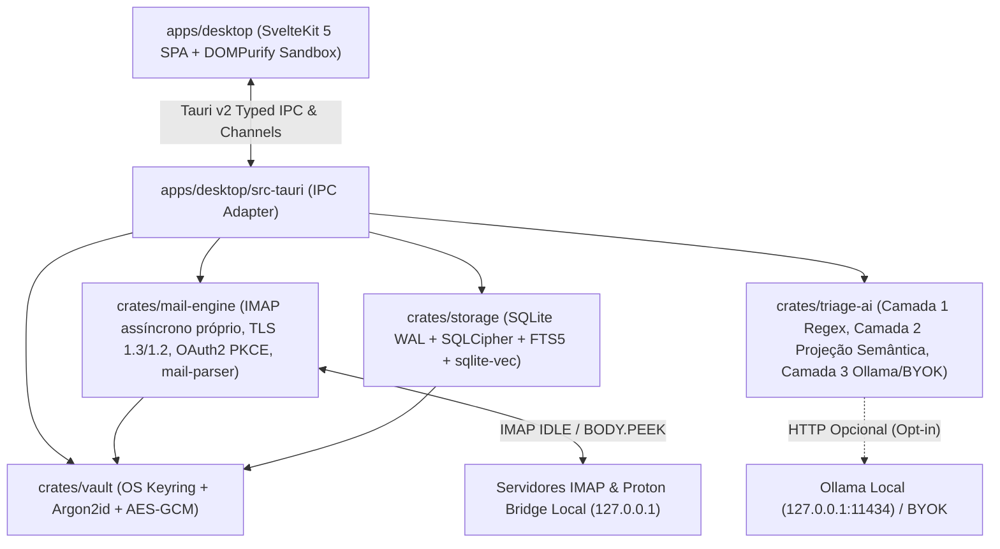

# triage-mail

**Agregador e Centro de Triagem de E-mails 100% Local-First e Agnóstico de Provedor, construído com Rust, Tauri v2, SQLite (SQLCipher + FTS5 + sqlite-vec) e SvelteKit 5.**

**[English](README.md)** | **[Português (Brasil)](README.pt-br.md)**

[](https://github.com/ye-sandbox/triage-mail/actions/workflows/ci.yml)


---

## Overview

O `triage-mail` é um motor de leitura unificada, busca híbrida instantânea e triagem automatizada de e-mails focado no fluxo de entrada (*Inbound*), projetado para usuários que gerenciam múltiplas contas (Gmail, Outlook/Microsoft 365, Yahoo, iCloud, Proton Mail Bridge e domínios próprios via IMAP). Em vez de operar como um cliente de e-mail tradicional pesado, o sistema atua exclusivamente na triagem rápida, extração inteligente e busca local.

Todas as credenciais, corpos de mensagens e índices vetoriais residem exclusivamente na máquina do usuário sob criptografia em repouso, com zero telemetria e sem dependências de runtimes externos pesados:

- **Binário Nativo & Baixo Consumo:** Stack pura em Rust (`tokio`) + Tauri v2 + SvelteKit 5 SPA (binário desktop nativo enxuto, sem Electron e sem sidecars Python/Node).
- **Busca Híbrida de Alta Performance:** Combina busca léxica exata configurável via SQLite `FTS5` (padrão `unicode61 remove_diacritics 2`, `trigram` opcional) e busca semântica vetorial KNN via extensão `sqlite-vec` embutida (quantização `int8` com pré-filtragem; $\le 15$ms semântica filtrada p95, ~52ms híbrida global p50 em 100k mensagens, ADR-008).
- **Caixa Unificada Virtualizada:** Projetada para lidar com `100k+` mensagens com pegada de memória delimitada ($\le 18$ linhas DOM montadas), triagem orientada por atalhos de teclado (*Command Palette*), sincronização incremental (`UIDVALIDITY`/`CONDSTORE`) e sincronização bidirecional de *flags* IMAP.
- **Autenticação Multimodo Transparente:** Suporte a Senhas de App (*App Passwords*), OAuth2 PKCE público, credenciais BYO OAuth fornecidas pelo usuário (`client_id`/`client_secret` salvos no cofre do SO), IMAP padrão (TLS 1.3 e TLS 1.2) e Proton Mail Bridge local através de um conector `ImapConnector` agnóstico.
- **Pipeline de IA Local-First em 3 Camadas:**
  - *Camada 1 (Determinística, Custo Zero):* Regex e heurísticas nativas em Rust para extração imediata de códigos 2FA/OTP, Boletos FEBRABAN (com extração determinística de valor em R\$ e data de vencimento), chaves/payloads Pix, metadados de NF-e, códigos de rastreio, `List-Unsubscribe` + cancelamento em 1 clique RFC 8058 (`List-Unsubscribe-Post`) e categorização automática (`Financeiro`, `Segurança`, `Newsletter`, `Pessoal`).
  - *Camada 2 (Projeção Semântica Experimental em CPU Local):* Projeções determinísticas de hash de tokens e n-grams (`int8[384]`) inicializadas a partir de cabeçalhos de modelos ou constantes offline para `sqlite-vec`; inferência neural com modelos ONNX está planejada para a v0.2.
  - *Camada 3 (LLM Generativo Opcional):* Resumos sob demanda via Ollama local (`http://127.0.0.1:11434`) ou provedores Cloud explícitos via BYOK (*Bring Your Own Key*).
- **Segurança Zero-Knowledge & Renderização Isolada:** Cofre do sistema operacional (`keyring` + cofre fallback `argon2`), armazenamento completo em SQLCipher AES-256, política de anexos sob demanda (*Lazy Attachments* via `IMAP BODY.PEEK`) e sanitização estrita de HTML (`DOMPurify` em `<iframe sandbox="">` com CSS base normalizado para modo escuro e bloqueio padrão de pixels de rastreamento).

## Architecture

O repositório é estruturado como um Cargo Workspace modular para que as crates principais em Rust (`mail-engine`, `storage`, `vault`, `triage-ai`) permaneçam desacopladas da interface gráfica e possam rodar de forma *headless* (CLI ou container Docker) no futuro:



## Status e Limitações Conhecidas

O `triage-mail` é um motor de entrada e triagem de e-mails em versão MVP (v0.1.0) com os seguintes limites empíricos de desempenho e escopo arquitetural:

- **Limites de Latência de Busca (ADR-008):** Em 100.000 mensagens no hardware de referência (AMD Ryzen 7 7700), as latências observadas em p95 warm são: semântica com filtro de partição $\le 15$ ms (12,9 ms), busca léxica $\le 40$ ms (37,3 ms), semântica exata global $\le 50$ ms (47,8 ms) e busca híbrida concorrente $\le 60$ ms (52,4 ms p50). A varredura vetorial exata global em 100k itens transmite 38,4 MB de embeddings `int8[384]` brutos através da descriptografia AES-256 do SQLCipher; busca vetorial global abaixo de 15ms é fisicamente inviável em CPU sem aproximações. Pré-filtragem de candidatos via quantização escalar de 1 bit (POPCNT Hamming distance) está agendada para avaliação na v0.2.
- **Exibição Nativa e Rolagem Virtual:** A lista de mensagens virtualizada mantém uma pegada de DOM delimitada ($\le 18$ linhas montadas) em 100k mensagens. Intervalos de callback de frame observados no WebKitGTK nativo registraram p95 em ~23ms sob Linux/WSL. Apresentação a 60fps acelerada por hardware depende dos drivers locais de GPU e compositor e não é garantida em todas as distribuições Linux.
- **Busca Semântica na Camada 2:** A Camada 2 utiliza atualmente projeções determinísticas experimentais de hash de características (`int8[384]`) inicializadas a partir da configuração de modelo. A integração com runtime neural ONNX está postergada para a v0.2.
- **Cliente IMAP Próprio (ADR-009):** A comunicação IMAP emprega um cliente assíncrono próprio desenvolvido sobre `tokio` e `tokio-rustls` (suportando TLS 1.3 e TLS 1.2, com pinning de certificado em loopback para Proton Mail Bridge), substituindo a biblioteca `async-imap` para garantir `#![forbid(unsafe_code)]` e busca tardia de corpos sem download de anexos via RFC 3501 `BODYSTRUCTURE`.
- **Escopo Exclusivo de Entrada (*Inbound-Only*):** O MVP v0.1 foca estritamente na sincronização, leitura local, busca e triagem de mensagens de entrada. Composição de e-mails e envio via SMTP estão postergados para a v0.2.
- **Escopo de Sincronização Multipasas:** A sincronização indexa pastas padrão (INBOX, Archive, Trash) com busca de partes de texto em duas fases. Anexos binários são baixados sob demanda via `IMAP BODY.PEEK[<part_id>]`.

## Quickstart

### Pré-requisitos

- **Toolchain Rust:** `rustup` (`stable`, edição Rust 2021/2024) + bibliotecas de sistema do Tauri v2 (`libwebkit2gtk-4.1-dev`, `libsecret-1-dev` no Linux).
- **Node.js & Gerenciador de Pacotes:** Node.js `24.19.0` e `pnpm 11.25.0` (mesmas versões do CI).

No Ubuntu 24.04, instale os pré-requisitos nativos de compilação (também usados pelo CI):

```bash
sudo apt-get update
sudo apt-get install --no-install-recommends -y \
  build-essential pkg-config perl libssl-dev libwebkit2gtk-4.1-dev \
  libgtk-3-dev libsecret-1-dev libayatana-appindicator3-dev librsvg2-dev
```

### Instalação e Verificação

```bash
# 1. Copie as variáveis padrão de desenvolvimento
cp .env.example .env

# 2. Instale as dependências do frontend
pnpm install --frozen-lockfile

# 3. Verifique a compilação e os testes unitários do workspace Rust
cargo test --workspace

# 4. Inicie o frontend; em outro terminal execute cargo run --package triage-mail-desktop
pnpm --filter desktop dev --port 1420
```

## Configuration

As credenciais de contas e chaves de criptografia do banco são armazenadas exclusivamente no cofre do sistema operacional (`crates/vault`), nunca em arquivos de texto plano. O arquivo `.env.example` define apenas parâmetros opcionais de desenvolvimento:

| Variable | Description | Default | Required |
| :--- | :--- | :--- | :--- |
| `RUST_LOG` | Diretivas de filtro de logs para as crates Rust | `info,triage_mail=debug,mail_engine=info,storage=info` | No |
| `TRIAGE_DB_PATH` | Caminho alternativo do banco SQLCipher para desenvolvimento | `./.agent/scratch/dev-triage.db` | No |
| `TRIAGE_EMBEDDING_MODEL` | Identificador de modelo para cache de artefatos da Camada 2 e resolução de seed | `all-MiniLM-L6-v2` | No |
| `OLLAMA_BASE_URL` | Endpoint HTTP do Ollama local para resumos sob demanda (Camada 3) | `http://127.0.0.1:11434` | No |
| `OLLAMA_MODEL` | Modelo padrão do Ollama local | `qwen2.5:3b` | No |
| `PROTON_BRIDGE_HOST` | Endereço de loopback local para o Proton Mail Bridge IMAP | `127.0.0.1` | No |
| `PROTON_BRIDGE_PORT` | Porta de loopback local para o Proton Mail Bridge IMAP | `1143` | No |

## Guia de Conexão de Contas e Autenticação

O `triage-mail` oferece suporte a quatro métodos de autenticação sob um transporte agnóstico de IMAP. Os principais provedores de e-mail bloqueiam o uso da senha normal da conta em conexões IMAP; utilize o método recomendado abaixo para cada serviço.

### Visão Geral dos Métodos de Autenticação

| Método | Indicado Para | Pré-requisitos | Serviços Compatíveis |
| :--- | :--- | :--- | :--- |
| **App Password** (Senha de App) | Configuração rápida e direta sem contas de desenvolvedor | Verificação em duas etapas (2FA) ativada na conta; IMAP ativado no webmail | Gmail, Google Workspace, iCloud, Yahoo, AOL, Fastmail, Outlook, IMAP próprio |
| **OAuth · Public PKCE** | Login seguro via navegador sem armazenar segredos de cliente | Provedor compatível com RFC 7636 PKCE e redirecionamento de loopback `127.0.0.1` | Microsoft 365, Outlook.com, Hotmail, provedores OIDC padrão |
| **OAuth · BYO Credentials** | Fluxo contínuo de tokens OAuth para Google ou servidores corporativos | Projeto de desenvolvedor com `client_id` e `client_secret` (aplicativo Desktop) | Google / Gmail (via Console GCP), SSO corporativo privado (Keycloak, Okta) |
| **Proton Mail Bridge** | Contas Proton Mail com criptografia de ponta a ponta | Plano pago do Proton + aplicativo oficial Proton Mail Bridge aberto localmente | Exclusivo para Proton Mail |

### Detalhes de Configuração por Provedor

#### Google / Gmail
- **Recomendado (Senha de Aplicativo):**
  1. Ative a verificação em duas etapas no painel de [Segurança da Conta Google](https://myaccount.google.com/security).
  2. Acesse [Senhas de app](https://myaccount.google.com/apppasswords) e crie uma senha de 16 caracteres (ex.: com o nome `Triage Mail`).
  3. Verifique se o IMAP está ativado no Gmail (*Configurações $\rightarrow$ Ver todas as configurações $\rightarrow$ Encaminhamento e POP/IMAP $\rightarrow$ Ativar IMAP*).
  4. No `triage-mail`, selecione **App password**: Host `imap.gmail.com`, Porta `993` e cole a senha de 16 caracteres gerada.
- **Alternativa (BYO OAuth):**
  1. Crie um projeto no [Google Cloud Console](https://console.cloud.google.com/).
  2. Configure a Tela de consentimento OAuth (Externa, com o escopo `https://mail.google.com/`).
  3. Crie Credenciais $\rightarrow$ ID do cliente OAuth $\rightarrow$ Tipo de aplicativo **App para computador** (Desktop app).
  4. No `triage-mail`, selecione **OAuth · Your client credentials**:
     - Endpoint de autorização: `https://accounts.google.com/o/oauth2/v2/auth`
     - Endpoint de token: `https://oauth2.googleapis.com/token`
     - Escopos: `https://mail.google.com/`
     - Client ID e Client Secret gerados no GCP.

#### Microsoft (Outlook.com / Hotmail / Microsoft 365)
- **Recomendado (OAuth · Public PKCE):**
  1. No `triage-mail`, selecione **OAuth · Public PKCE**.
  2. Host: `outlook.office365.com`, Porta: `993`.
  3. Endpoint de autorização: `https://login.microsoftonline.com/common/oauth2/v2.0/authorize`
  4. Endpoint de token: `https://login.microsoftonline.com/common/oauth2/v2.0/token`
  5. Escopos: `offline_access https://outlook.office.com/IMAP.AccessAsUser.All`
  6. Client ID: ID de aplicativo público da Microsoft registrado para PKCE desktop.
- **Alternativa (Senha de Aplicativo):**
  1. Se a verificação em duas etapas estiver ativada na sua conta Microsoft, gere uma senha de aplicativo em *Opções de segurança avançadas*.
  2. No `triage-mail`, selecione **App password**: Host `outlook.office365.com`, Porta `993`.

#### Apple iCloud Mail
1. Ative a autenticação de dois fatores no seu ID Apple.
2. Acesse [appleid.apple.com](https://appleid.apple.com) e navegue até *Início de sessão e segurança $\rightarrow$ Senhas específicas de apps*.
3. Gere uma nova senha para o `triage-mail`.
4. No `triage-mail`, selecione **App password**:
   - Host: `imap.mail.me.com`
   - Porta: `993`
   - E-mail: seu endereço de e-mail iCloud
   - Senha: a senha específica gerada pela Apple.

#### Yahoo Mail & AOL
1. Acesse *Informações da conta $\rightarrow$ Segurança da conta*.
2. Role até *Gerar senha de aplicativo* e selecione *Outro aplicativo* $\rightarrow$ digite `triage-mail`.
3. No `triage-mail`, selecione **App password**:
   - Host: `imap.mail.yahoo.com` (ou `imap.aol.com` para AOL)
   - Porta: `993`
   - Senha: a senha de aplicativo de 16 caracteres.

#### Proton Mail (via Proton Mail Bridge)
1. Confirme se você possui uma assinatura paga ativa do Proton (obrigatória pela Proton para liberar o Bridge).
2. Baixe, instale e abra o aplicativo oficial **Proton Mail Bridge** na sua máquina.
3. Adicione sua conta Proton dentro do Bridge e aguarde a sincronização local.
4. Nas configurações do Bridge, confirme que o IMAP está em modo SSL/TLS (porta padrão `1143`).
5. Abra os detalhes da conta no Proton Mail Bridge para visualizar o **Username** e o **Password** do Bridge.
6. No `triage-mail`, selecione **Proton Mail Bridge**:
   - Host: `127.0.0.1` (estritamente loopback local)
   - Porta: `1143`
   - Username: Nome de usuário exibido no Bridge
   - Senha do Bridge: A senha gerada pelo aplicativo Bridge (*nunca* a senha principal da sua conta Proton).

#### Servidores IMAP Próprios / Corporativos (Dovecot, Postfix, Zimbra, cPanel)
1. No `triage-mail`, selecione **App password**.
2. Preencha seu endereço de e-mail completo, o endereço do servidor IMAP (ex.: `mail.example.org`) e a porta TLS (`993`).
3. Insira sua senha normal ou token de aplicativo gerado no painel do servidor.

## Usage

```bash
# Executar testes das crates core (parser MIME, triagem determinística 2FA/Boleto, storage)
cargo test --workspace

# Compilar a SPA e depois o binário desktop nativo (sem empacotar instalador)
pnpm --filter desktop build
cargo build --release --package triage-mail-desktop
```

## Development

### Estrutura do Repositório

```text
.
├── .agent/                   # Governança ADD, contratos ativos (NOTES.md) e roadmap (TASK.md)
├── apps/
│   └── desktop/              # Frontend SvelteKit 5 SPA + entrypoint Tauri v2 (src-tauri)
├── crates/
│   ├── mail-engine/          # Conector IMAP assíncrono, OAuth2 PKCE, IDLE Manager e MIME Parser
│   ├── storage/              # SQLite WAL + SQLCipher, migrations, FTS5 e sqlite-vec
│   ├── triage-ai/            # Camada 1 Regex (2FA/Boletos/Rastreio), Camada 2 Projeção Semântica e Camada 3 LLM
│   └── vault/                # Integração com OS Keyring e criptografia Argon2id + AES-GCM
├── docs/
│   └── adr/                  # Registros de Decisões Arquiteturais (decisions.md)
├── AGENTS.md                 # Diretrizes de engenharia, invariantes e Definition of Done
├── Cargo.toml                # Manifesto do Cargo Workspace em Rust
└── package.json              # Manifesto do workspace frontend
```

### Comandos de Validação

O [workflow de CI](.github/workflows/ci.yml) executa em pull requests, pushes para `main`
e acionamento manual, com Ubuntu 24.04, Rust 1.99.0 com rustfmt/Clippy, Node.js 24.19.0
e pnpm 11.25.0. As actions usam hashes de commit; as credenciais do checkout não persistem.
A instalação de dependências requer registros de pacotes/toolchains e repositórios Ubuntu.
A validação Rust roda offline após `cargo fetch --locked`; os testes usam dados sintéticos
e servidores locais em loopback, sem credenciais de provedores nem downloads de modelos.
O CI não publica artefatos.

O verificador de políticas, sem dependências, lê arquivos de texto rastreados na árvore de
trabalho, permite domínios reservados de exemplo/teste, rejeita outros endereços de e-mail e
formatos específicos de segredos, e verifica sintaxe legada nos componentes/módulos Runes
Svelte. Exibe apenas locais e nomes das regras, sem os valores encontrados. É uma proteção
limitada, não uma auditoria completa de segredos ou do histórico Git; revise mudanças de
credenciais manualmente. Adicione arquivos novos ao staging antes da verificação local.

```bash
# Verificações do Workspace Rust
cargo check --workspace
cargo test --workspace
cargo fmt --all -- --check
cargo clippy --workspace --all-targets -- -D warnings

# Verificações do Frontend (apps/desktop)
pnpm --filter desktop check
pnpm --filter desktop test
pnpm --filter desktop build

node --test scripts/ci-guard.test.mjs
node scripts/ci-guard.mjs
git diff --check
```

A validação opcional de desempenho usa dados sintéticos para busca SQLCipher com 100.000
mensagens e uma instância separada da interface nativa WebKitGTK, medindo intervalos entre
frames e memória da árvore de processos. Consulte
[metodologia, comandos e limites medidos](docs/performance/native-validation.md).
Essas ferramentas não acessam provedores nem baixam modelos; recompile a SPA normal após a
compilação da interface de teste antes de gerar o binário do aplicativo.

## License

Licenciado sob a **GNU Affero General Public License v3.0 (AGPLv3)** — consulte [`LICENSE`](LICENSE) para mais detalhes.
